# Anexo A. Explicaciones locales de los quince contratos de estudio

Este anexo acompaña la sección 8.4.3 del trabajo de grado *Clasificación de Alertas de Riesgo Contractual en el Departamento del Atlántico mediante Aprendizaje Automático Supervisado e Inteligencia Artificial Explicable*.

Presenta el desglose del puntaje de los quince contratos de prueba (2024) con alerta seleccionados al azar, con semilla fija. Cinco solo cumplen la regla de adiciones, cinco solo cumplen la de prórrogas y cinco cumplen ambas. En cada figura, las barras muestran la contribución SHAP de cada descriptor en el modelo XGBoost, en log-odds, y su suma con el valor base del modelo reproduce el puntaje del contrato. Los contratos se identifican solo con un código interno, sin datos del contratista ni de la entidad.

Las figuras se generan con el script `SCRIPTS/3_modelado/05_shap.py`.

## Figura A1. Desglose del puntaje del caso C01 (solo regla de adiciones)

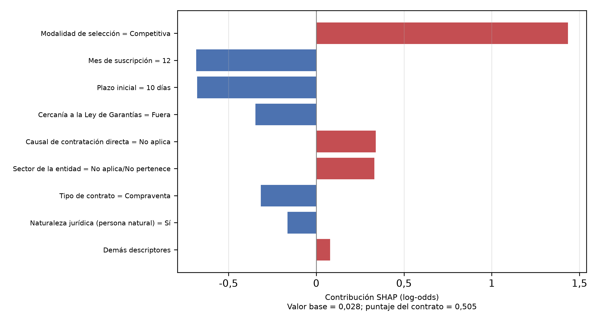

Fuente: Elaboración propia.

## Figura A2. Desglose del puntaje del caso C02 (solo regla de adiciones)

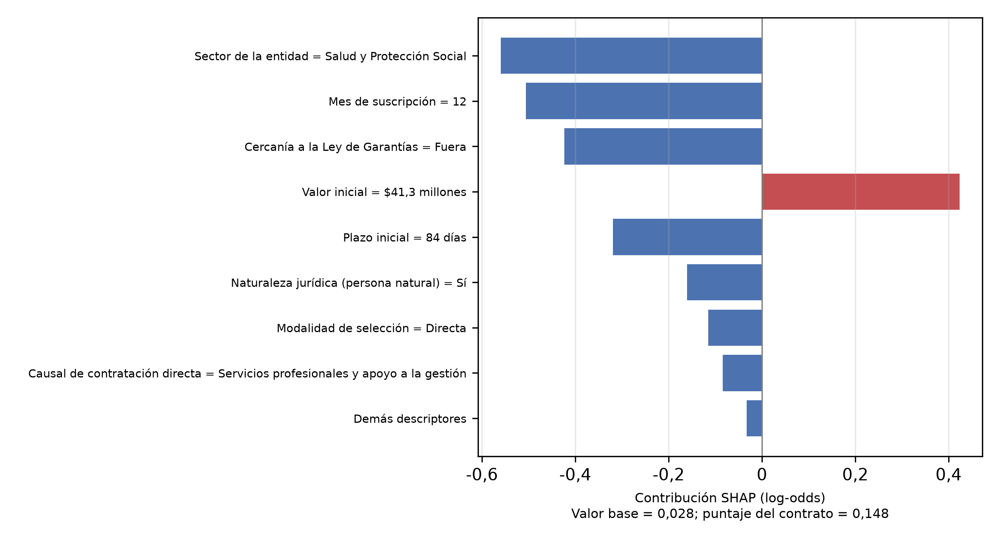

Fuente: Elaboración propia.

## Figura A3. Desglose del puntaje del caso C03 (solo regla de adiciones)

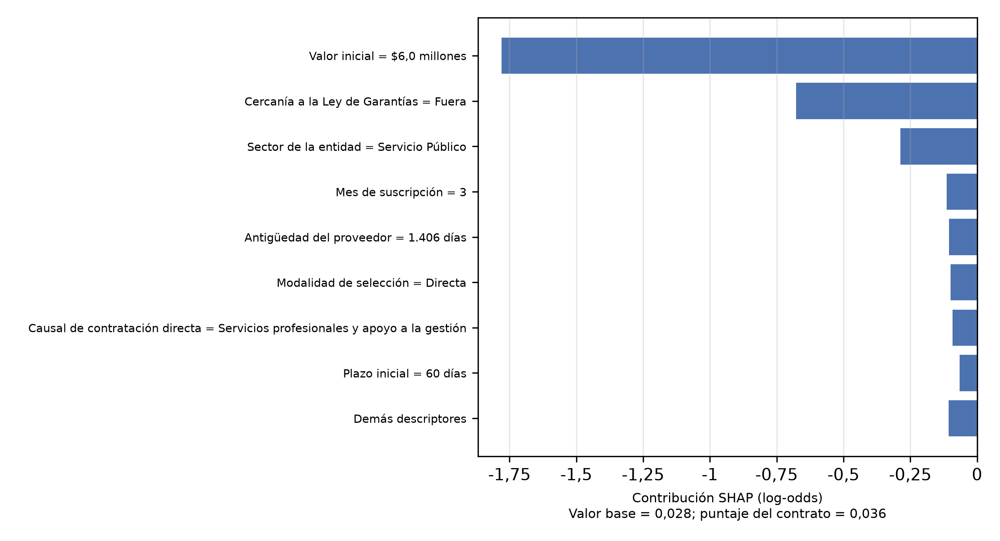

Fuente: Elaboración propia.

## Figura A4. Desglose del puntaje del caso C04 (solo regla de adiciones)

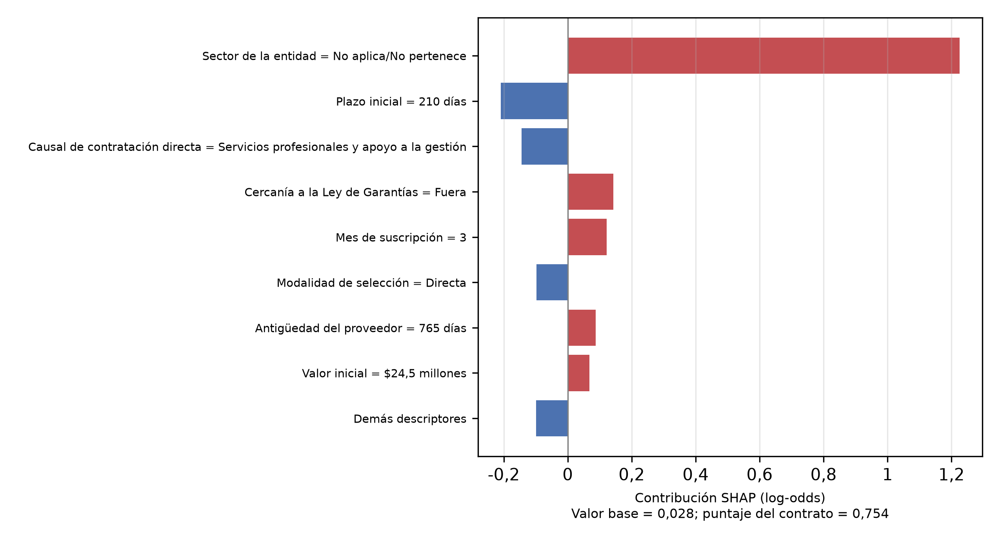

Fuente: Elaboración propia.

## Figura A5. Desglose del puntaje del caso C05 (solo regla de adiciones)

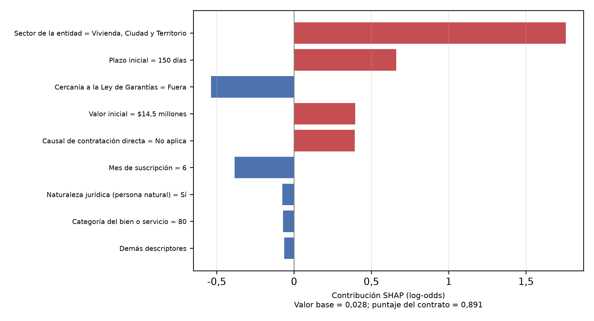

Fuente: Elaboración propia.

## Figura A6. Desglose del puntaje del caso C06 (solo regla de prórrogas)

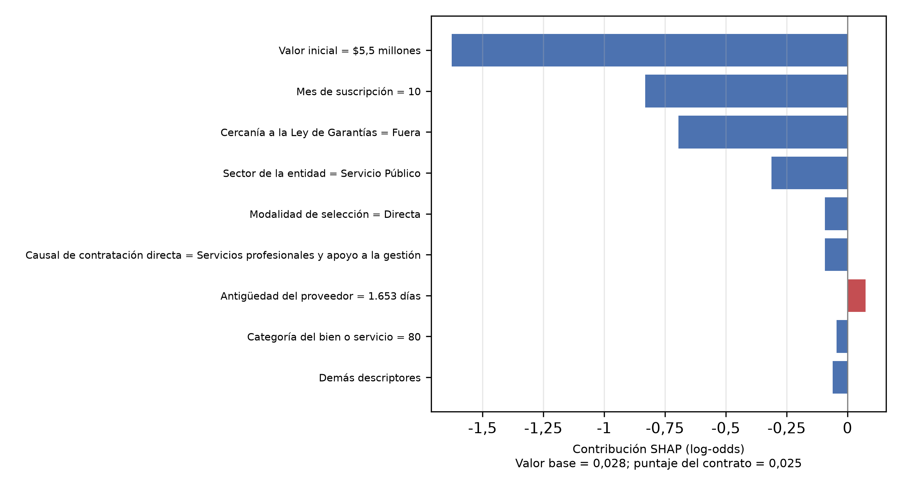

Fuente: Elaboración propia.

## Figura A7. Desglose del puntaje del caso C07 (solo regla de prórrogas)

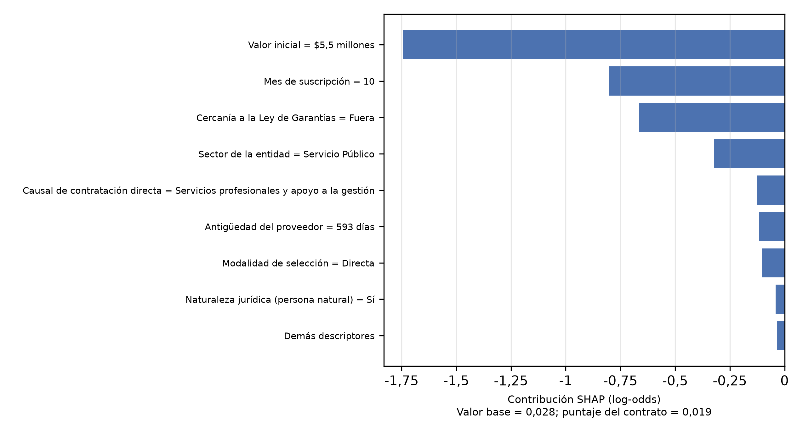

Fuente: Elaboración propia.

## Figura A8. Desglose del puntaje del caso C08 (solo regla de prórrogas)

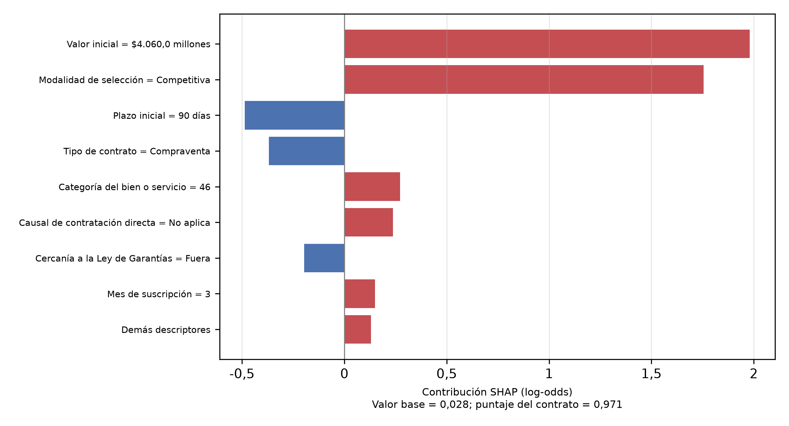

Fuente: Elaboración propia.

## Figura A9. Desglose del puntaje del caso C09 (solo regla de prórrogas)

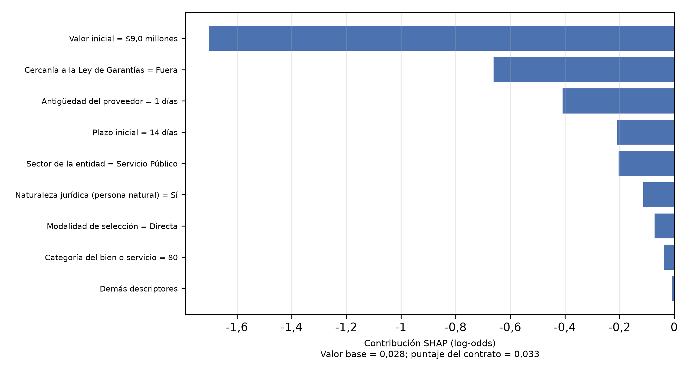

Fuente: Elaboración propia.

## Figura A10. Desglose del puntaje del caso C10 (solo regla de prórrogas)

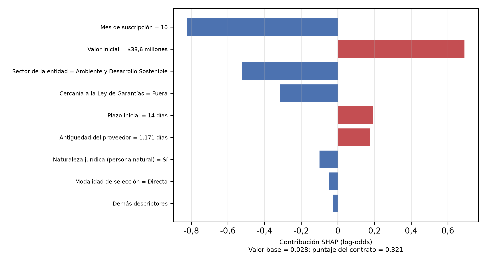

Fuente: Elaboración propia.

## Figura A11. Desglose del puntaje del caso C11 (reglas de adiciones y prórrogas)

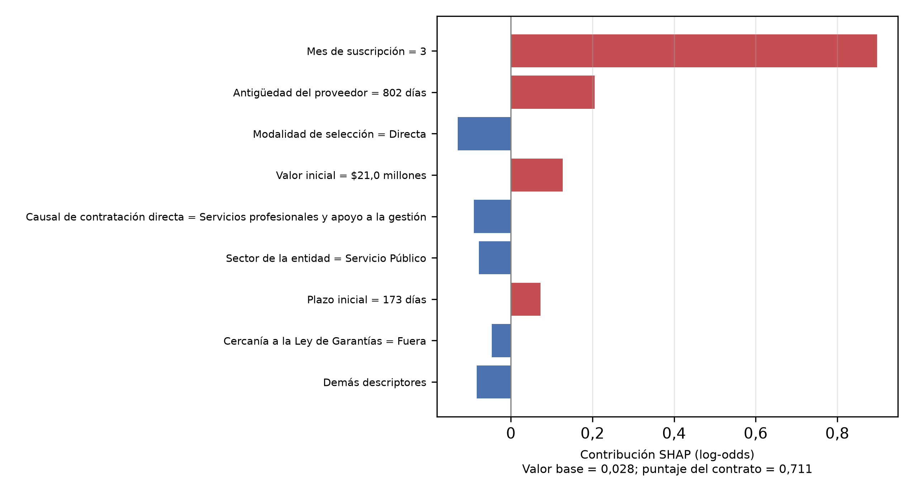

Fuente: Elaboración propia.

## Figura A12. Desglose del puntaje del caso C12 (reglas de adiciones y prórrogas)

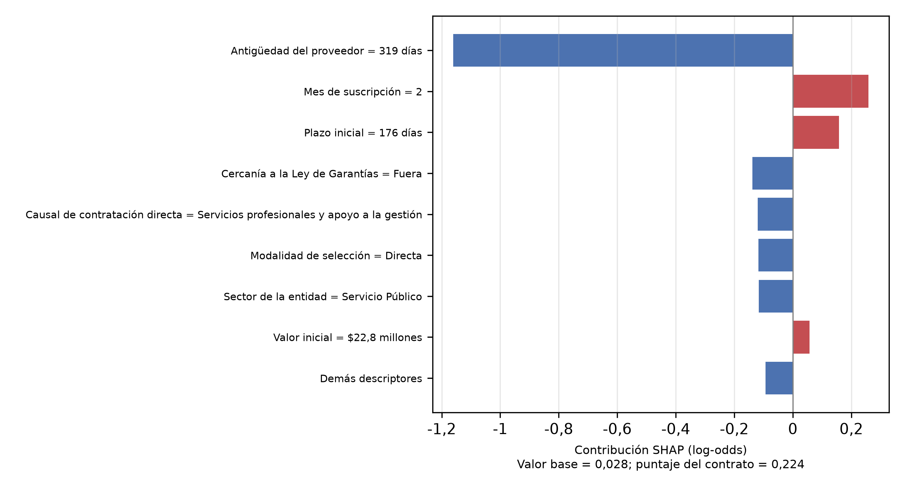

Fuente: Elaboración propia.

## Figura A13. Desglose del puntaje del caso C13 (reglas de adiciones y prórrogas)

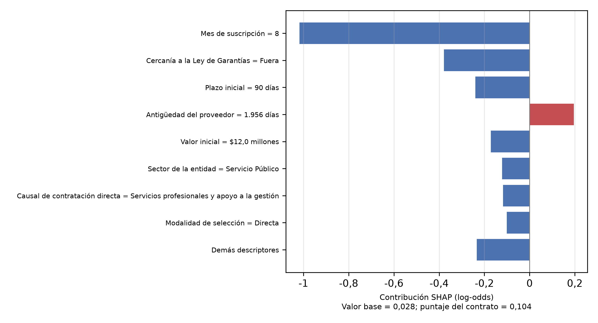

Fuente: Elaboración propia.

## Figura A14. Desglose del puntaje del caso C14 (reglas de adiciones y prórrogas)

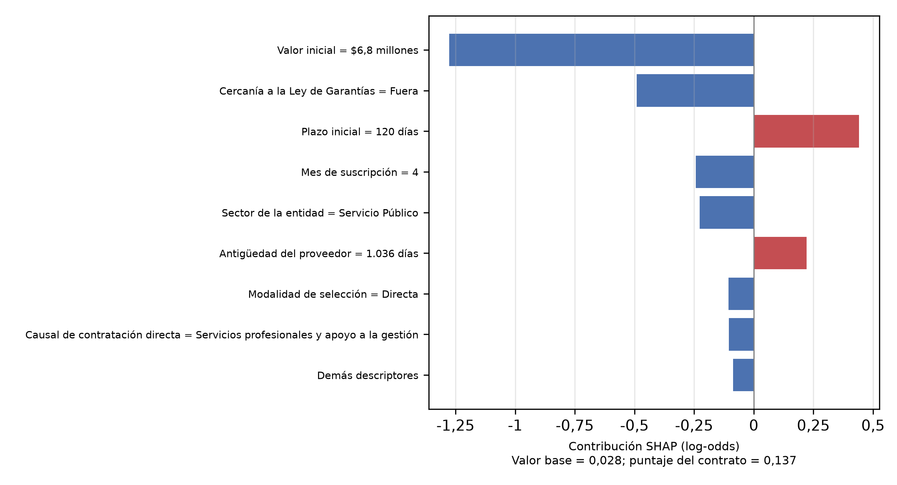

Fuente: Elaboración propia.

## Figura A15. Desglose del puntaje del caso C15 (reglas de adiciones y prórrogas)

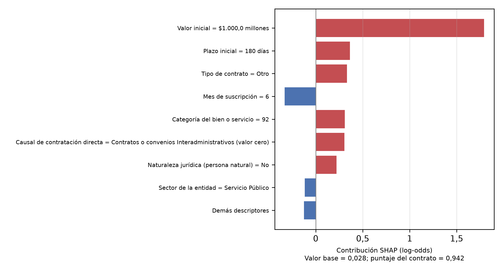

Fuente: Elaboración propia.
