# Anexo A. Explicaciones locales de los quince contratos de estudio

Este anexo complementa la sección 8.4.3 del trabajo de grado *Clasificación de Alertas de Riesgo Contractual en el Departamento del Atlántico mediante Aprendizaje Automático Supervisado e Inteligencia Artificial Explicable*. Presenta el resumen y el desglose del puntaje de los quince contratos de prueba (2024) con alerta seleccionados al azar, con semilla fija, cinco que solo cumplen la regla de adiciones, cinco que solo cumplen la de prórrogas y cinco que cumplen ambas. Los contratos se identifican solo con un código interno, sin datos del contratista ni de la entidad.

En cada caso, el valor base del modelo (0,028 en log-odds, equivalente a un puntaje de 0,507) más la suma de las contribuciones SHAP de los doce descriptores reproduce el puntaje del contrato. El valor base es cercano a 0,5 porque los pesos de clase equilibran la influencia de las dos clases durante el entrenamiento (sección 7.4.4 del documento).

**Tabla A1.** Explicaciones locales de quince contratos de prueba con alerta

| Código | Reglas que cumple | Puntaje | ¿Supera el umbral? | Tres contribuciones de mayor magnitud (log-odds) |
|---|---|---|---|---|
| C01 | Solo adiciones | 0,506 | Sí | Modalidad competitiva (+1,43); mes 12 (−0,68); plazo de 10 días (−0,68) |
| C02 | Solo adiciones | 0,148 | No | Sector Salud y Protección Social (−0,56); mes 12 (−0,51); fuera de la Ley de Garantías (−0,42) |
| C03 | Solo adiciones | 0,036 | No | Valor de $6,0 millones (−1,78); fuera de la Ley de Garantías (−0,68); sector Servicio Público (−0,29) |
| C04 | Solo adiciones | 0,754 | Sí | Sector no aplica (+1,22); plazo de 210 días (−0,21); causal de servicios profesionales (−0,14) |
| C05 | Solo adiciones | 0,891 | Sí | Sector Vivienda, Ciudad y Territorio (+1,76); plazo de 150 días (+0,66); fuera de la Ley de Garantías (−0,54) |
| C06 | Solo prórrogas | 0,025 | No | Valor de $5,5 millones (−1,63); mes 10 (−0,83); fuera de la Ley de Garantías (−0,69) |
| C07 | Solo prórrogas | 0,019 | No | Valor de $5,5 millones (−1,74); mes 10 (−0,80); fuera de la Ley de Garantías (−0,66) |
| C08 | Solo prórrogas | 0,971 | Sí | Valor de $4.060 millones (+1,98); modalidad competitiva (+1,75); plazo de 90 días (−0,49) |
| C09 | Solo prórrogas | 0,033 | No | Valor de $9,0 millones (−1,70); fuera de la Ley de Garantías (−0,66); antigüedad de 1 día (−0,41) |
| C10 | Solo prórrogas | 0,321 | No | Mes 10 (−0,82); valor de $33,6 millones (+0,69); sector Ambiente y Desarrollo Sostenible (−0,52) |
| C11 | Adiciones y prórrogas | 0,711 | Sí | Mes 3 (+0,90); antigüedad de 802 días (+0,20); modalidad directa (−0,13) |
| C12 | Adiciones y prórrogas | 0,224 | No | Antigüedad de 319 días (−1,16); mes 2 (+0,26); plazo de 176 días (+0,16) |
| C13 | Adiciones y prórrogas | 0,104 | No | Mes 8 (−1,02); fuera de la Ley de Garantías (−0,38); plazo de 90 días (−0,24) |
| C14 | Adiciones y prórrogas | 0,137 | No | Valor de $6,8 millones (−1,28); fuera de la Ley de Garantías (−0,49); plazo de 120 días (+0,44) |
| C15 | Adiciones y prórrogas | 0,942 | Sí | Valor de $1.000 millones (+1,79); plazo de 180 días (+0,36); tipo de contrato Otro (+0,33) |

Fuente: Elaboración propia

Nota. Contratos de 2024 identificados con un código interno, sin datos del contratista ni de la entidad (sección 7.4.7). Umbral de decisión de XGBoost: 0,483 (sección 8.3.3 del documento).

## Lectura de los casos

- Con su umbral de decisión, el modelo señala tres de los cinco contratos que solo cumplen la regla de adiciones, uno de los cinco que solo cumplen la de prórrogas y dos de los cinco que cumplen ambas.
- Entre los señalados, el puntaje se explica por un valor alto (C08 y C15), por la modalidad competitiva (C01 y C08), por el sector de la entidad (C04 y C05) o por la firma en el primer trimestre (C11).
- Entre los no señalados, la contribución de mayor magnitud es la de un valor inicial inferior a $10 millones en C03, C06, C07, C09 y C14.
- La contribución negativa de la Ley de Garantías aparece entre las tres principales en ocho de los quince casos, como un descuento común a todos los contratos de 2024 (sección 8.4.1 del documento).

## Desglose del puntaje por caso

En cada figura, las barras muestran la contribución SHAP de cada descriptor en el modelo XGBoost, en log-odds. El desglose del caso C08 se presenta en la Figura 4 del documento y no se repite aquí. Las figuras se generan con el script `SCRIPTS/3_modelado/05_shap.py`.

**Figura A1.** Desglose del puntaje del caso C01 (solo regla de adiciones)

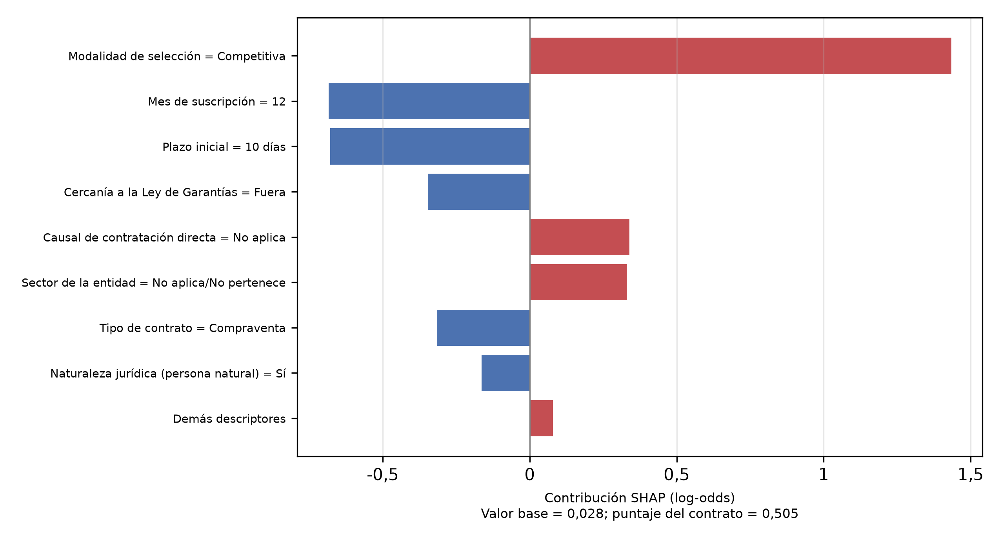

Fuente: Elaboración propia

**Figura A2.** Desglose del puntaje del caso C02 (solo regla de adiciones)

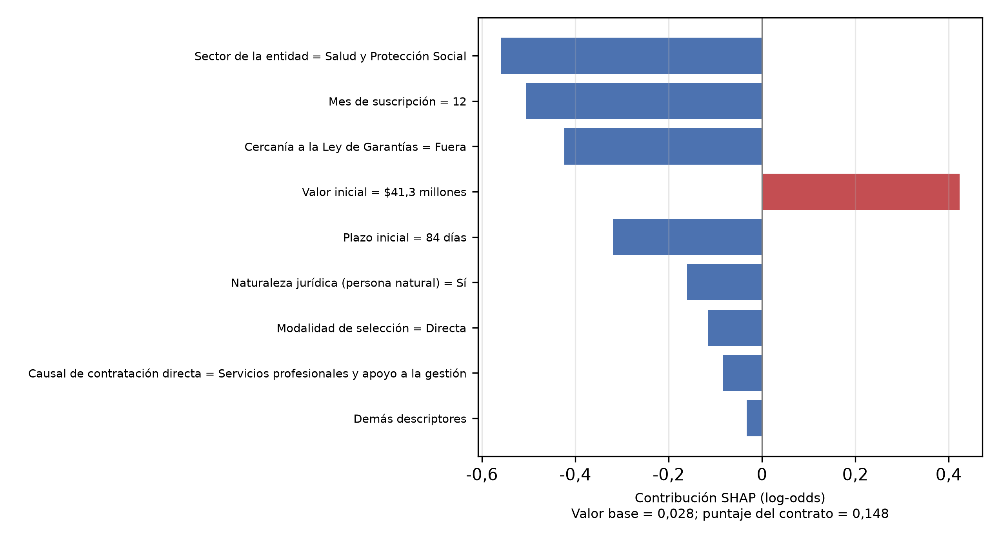

Fuente: Elaboración propia

**Figura A3.** Desglose del puntaje del caso C03 (solo regla de adiciones)

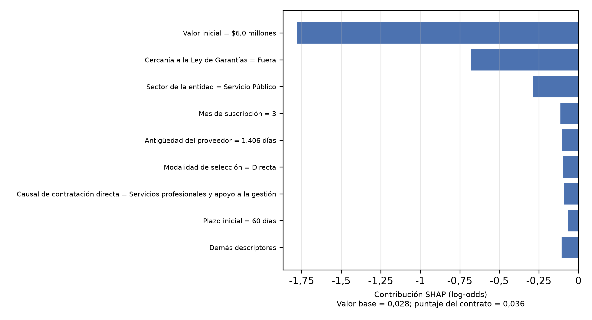

Fuente: Elaboración propia

**Figura A4.** Desglose del puntaje del caso C04 (solo regla de adiciones)

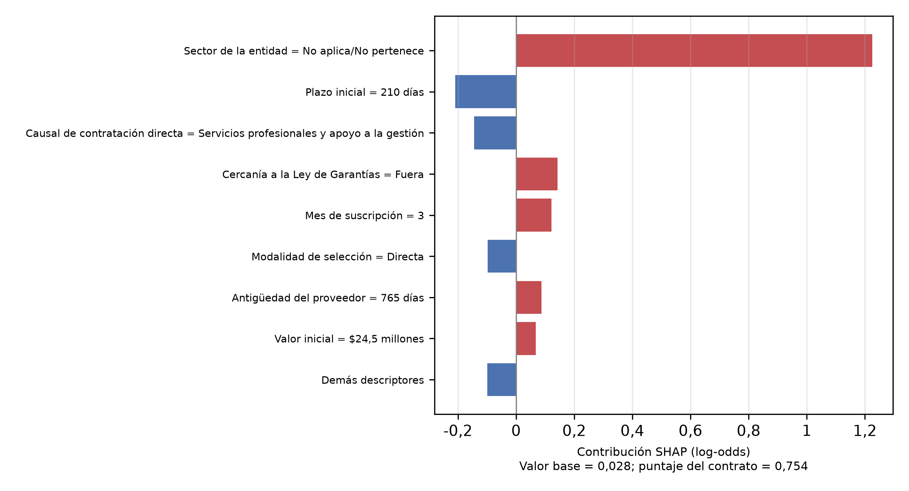

Fuente: Elaboración propia

**Figura A5.** Desglose del puntaje del caso C05 (solo regla de adiciones)

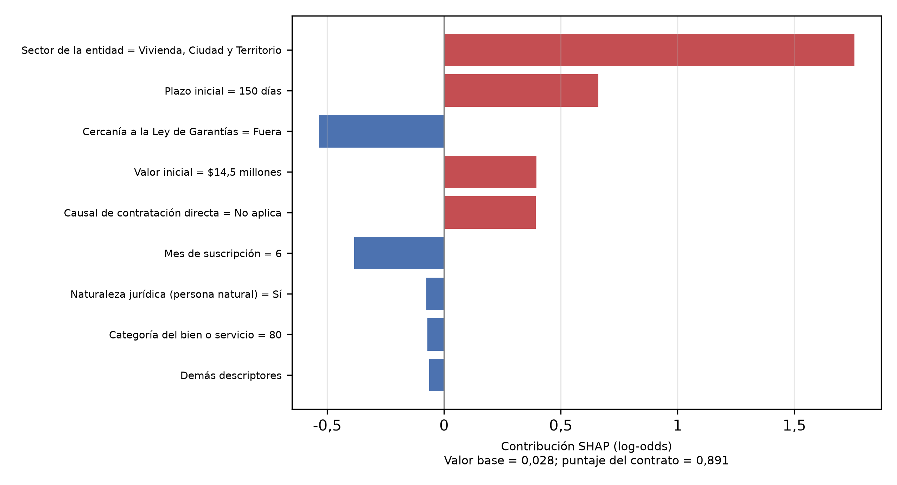

Fuente: Elaboración propia

**Figura A6.** Desglose del puntaje del caso C06 (solo regla de prórrogas)

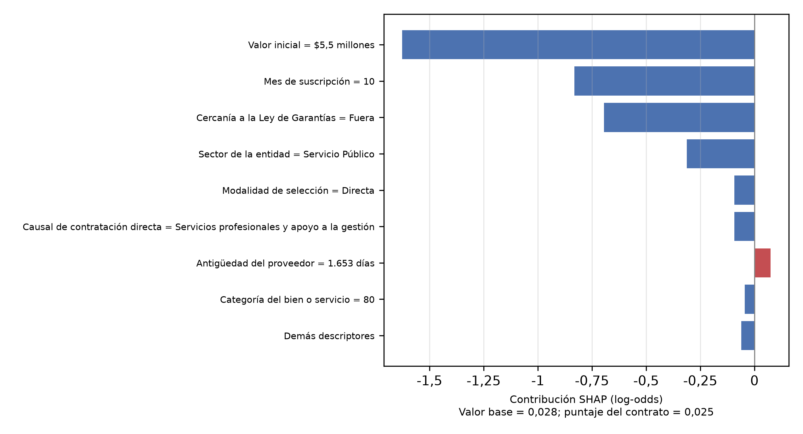

Fuente: Elaboración propia

**Figura A7.** Desglose del puntaje del caso C07 (solo regla de prórrogas)

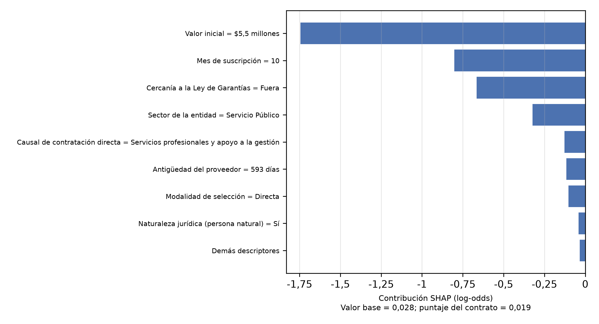

Fuente: Elaboración propia

**Figura A8.** Desglose del puntaje del caso C09 (solo regla de prórrogas)

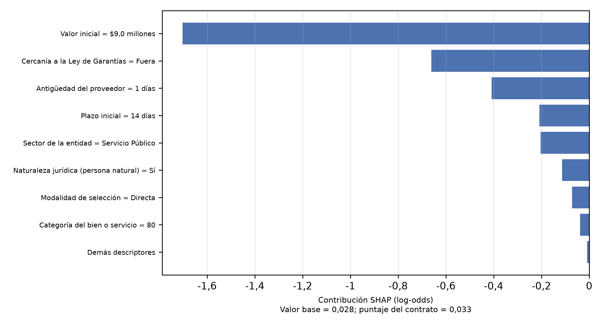

Fuente: Elaboración propia

**Figura A9.** Desglose del puntaje del caso C10 (solo regla de prórrogas)

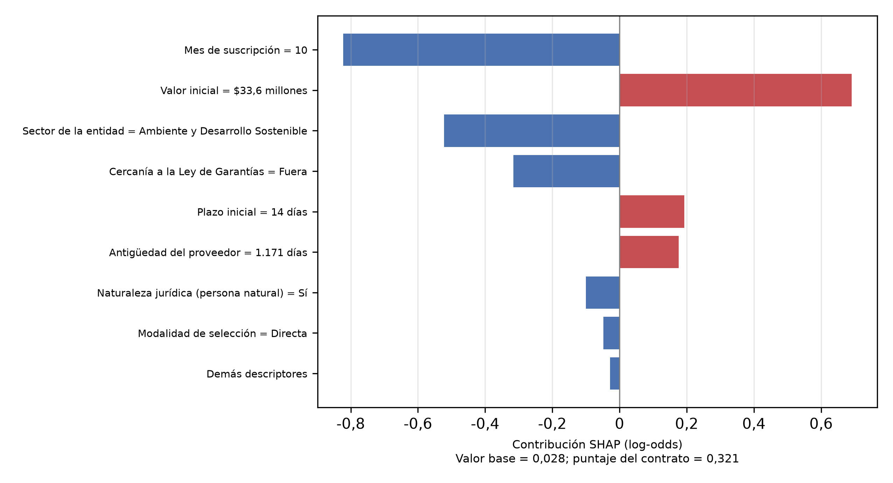

Fuente: Elaboración propia

**Figura A10.** Desglose del puntaje del caso C11 (reglas de adiciones y prórrogas)

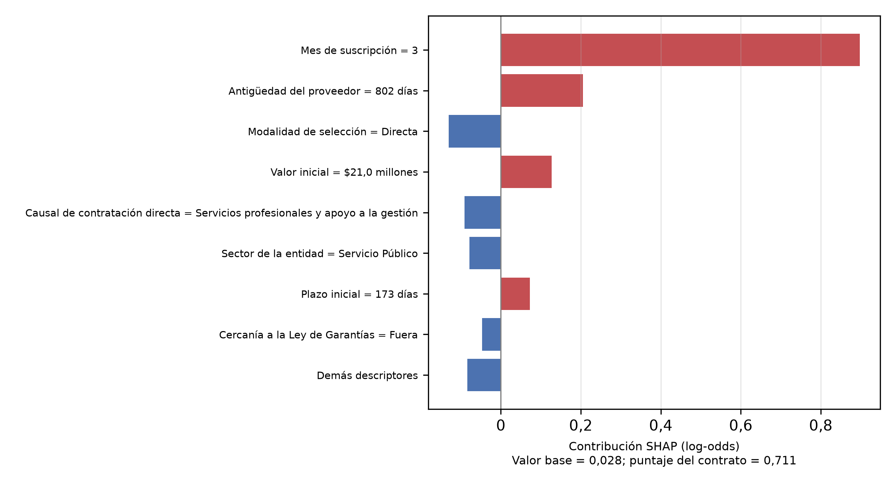

Fuente: Elaboración propia

**Figura A11.** Desglose del puntaje del caso C12 (reglas de adiciones y prórrogas)

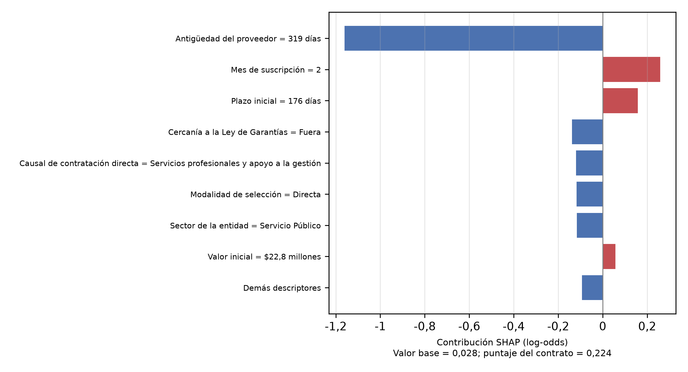

Fuente: Elaboración propia

**Figura A12.** Desglose del puntaje del caso C13 (reglas de adiciones y prórrogas)

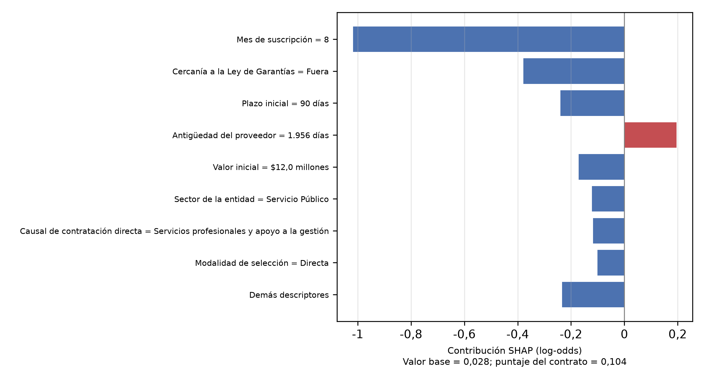

Fuente: Elaboración propia

**Figura A13.** Desglose del puntaje del caso C14 (reglas de adiciones y prórrogas)

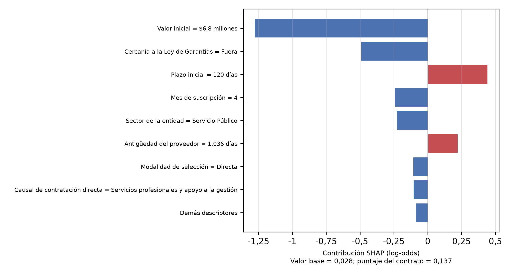

Fuente: Elaboración propia

**Figura A14.** Desglose del puntaje del caso C15 (reglas de adiciones y prórrogas)

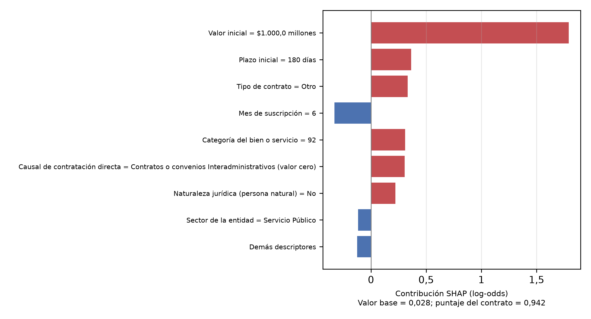

Fuente: Elaboración propia
