# Anexo E. Trabajo de campo ampliado

Este anexo acompaña el capítulo 8 (Trabajo de Campo) del trabajo de grado *Clasificación de Alertas de Riesgo Contractual en el Departamento del Atlántico mediante Aprendizaje Automático Supervisado e Inteligencia Artificial Explicable*. Presenta la versión completa del capítulo, con todas sus tablas y figuras, que en el documento se resume para ajustarse a la extensión de la plantilla de monografía. Las secciones conservan la numeración del documento, y las tablas y figuras conservan la numeración que tenían en la versión completa. Los resultados provienen de los scripts de la carpeta `SCRIPTS/3_modelado` de este repositorio.

## 8.1 Procesamiento de Datos y Análisis Exploratorio (EDA)

### 8.1.1 Acceso, Consolidación y Depuración de los Datos

El procesamiento de los datos se realizó en cinco etapas, cada una implementada en un grupo de scripts del repositorio del proyecto (sección 7.4.7). La descarga de los conjuntos de datos, su consolidación en un archivo por fuente, la revisión de la calidad de cada archivo, la selección de las columnas útiles para el estudio y la integración en una única tabla de modelado.

Etapa 1. Descarga

La extracción de los cinco conjuntos de datos se extendió por cerca de un mes y estuvo condicionada por la inestabilidad del portal datos.gov.co, que en varias ocasiones no respondía o interrumpía las descargas antes de completarse. Además, los conjuntos de Modificaciones y Adiciones no incluyen el departamento de la entidad contratante, de modo que debieron descargarse completos a nivel nacional, con más de 26 millones de registros solo en Modificaciones, para filtrarlos después en el equipo local. Por eso la descarga combinó tres modalidades, la exportación directa desde el portal, la descarga programática por año o por mes mediante la API y, en los casos más críticos, la descarga día por día (Tabla 10). Una primera descarga de Adiciones se descartó porque el portal entregó fechas alteradas, y el conjunto se descargó de nuevo mes a mes. Al cruzar las fuentes se encontró, además, que el conjunto de Contratos registra el valor y el plazo vigentes, ya actualizados con las adiciones y prórrogas, lo que llevó a incorporar un quinto conjunto, el de Procesos de Contratación, como fuente del valor y el plazo pactados al firmar. Cada archivo se verificó contra los conteos oficiales del portal antes de darlo por válido. Para más detalles sobre las fallas del portal y la forma en que se resolvió cada una, ver el Anexo B (capítulo 12).

**Tabla 10. Estrategia de descarga por conjunto de datos**

| Conjunto | Alcance de la descarga | Archivos | Tamaño | Método final |
|---|---|---|---|---|
| Contratos Electrónicos | Atlántico, firma 2021–2024 | 4 | 187 MB | Exportación directa por año |
| Procesos de Contratación | Atlántico, publicación 2019–2024 y procesos sin fecha de publicación | 7 | 37 MB | API por año |
| Proveedores Registrados | Nacional, registro completo al 5 de octubre de 2026 | 1 | 610 MB | Exportación directa |
| Adiciones | Nacional, enero de 2021 a agosto de 2026 | 68 | 2,5 GB | API mes a mes |
| Modificaciones | Nacional, enero de 2021 a agosto de 2026 | 26 | 23 GB | Exportación directa (2021–2024 y parte de 2026), API por mes (2025 y 2026) y API por día (28 a 31 de agosto de 2026) |

Fuente: Elaboración propia

Etapa 2. Consolidación por fuente

Con los datos completos, los archivos descargados de cada conjunto se unieron en un único archivo por fuente. El archivo de contratos reúne los 109.979 contratos del Departamento del Atlántico firmados entre 2021 y 2024, y los otros cuatro se filtraron a esos contratos: Modificaciones y Adiciones por el identificador del contrato, Procesos de Contratación por el identificador del proceso de compra, y Proveedores Registrados por el código de los contratistas. En los cinco archivos se eliminaron los registros duplicados, se normalizaron los formatos de fechas y valores, y se suprimieron las columnas con datos personales (sección 7.4.7). En Modificaciones, varios de los archivos descargados cubrían periodos que se solapaban. Por eso, a cada archivo se le asignó una ventana de fechas de aprobación y se descartaron los 4.608 registros que quedaban fuera de ella, para no contar dos veces una misma modificación. Así, de los 26,4 millones de registros leídos a nivel nacional, 255.391 correspondían a los contratos del estudio. Al eliminar 38.276 duplicados exactos quedaron 217.115 registros, que equivalen a 106.895 modificaciones distintas sobre 65.758 contratos. Los resultados por fuente se presentan en la Tabla 11.

**Tabla 11. Resultados de la consolidación por fuente de datos**

| Fuente | Registros leídos | Registros conservados | Observaciones |
|---|---|---|---|
| Contratos Electrónicos | 109.979 | 109.979 | Sin duplicados; se eliminaron 20 columnas con datos personales |
| Procesos de Contratación | 132.334 | 73.731 (69.974 procesos) | 4.082 contratos sin proceso asociado; 5.505 filas corresponden a procesos registrados más de una vez |
| Proveedores Registrados | 1.619.281 | 35.780 | 558 proveedores de los contratos sin registro en el conjunto |
| Adiciones | 7.308.238 | 108.962 (66.395 contratos) | Sin duplicados ni registros posteriores a la fecha de corte |
| Modificaciones | 26.399.150 | 217.115 (106.895 modificaciones; 65.758 contratos) | 38.276 duplicados exactos eliminados; 112.359 registros en estado publicado o aprobado |

Fuente: Elaboración propia

Etapa 3. Revisión de calidad de cada fuente

Antes de construir las variables se examinó cada archivo consolidado para identificar valores faltantes, columnas sin información, registros repetidos y la composición de los campos clave. Las cifras de esta revisión, y las de la Etapa 5, se obtienen con el script de revisión de calidad del repositorio del proyecto (sección 7.4.7):

En Contratos Electrónicos, ocho columnas estaban completamente vacías: las cinco del desglose de las fuentes de recursos, la fecha de última actualización y las dos fechas de liquidación. La fecha de notificación de prórroga estaba vacía en el 87,0 % de los contratos. De las columnas necesarias para el estudio, solo la fecha de inicio tenía celdas vacías (1,2 %); en esos casos se usó la fecha de firma para verificar si el plazo había vencido (sección 7.2.2). Otras columnas no tenían celdas vacías, pero sí registros sin información: la categoría UNSPSC figuraba como no especificada en 677 contratos (0,6 %), el tipo de documento del proveedor como no definido en 63, y el tipo de contrato y la justificación de la modalidad como no especificados en cinco cada uno. La revisión confirmó, además, que este conjunto registra el valor vigente del contrato. En los 6.899 contratos de la población final con adiciones, el valor registrado coincide con la suma del valor inicial y las adiciones en el 98,7 % de los casos, con una diferencia menor al 1 %, y con el valor inicial solo en el 1,5 %. Esto confirma la necesidad de tomar el valor y el plazo pactados del conjunto de Procesos de Contratación (Etapa 1).

En Procesos de Contratación, los campos de valor adjudicado, precio base, duración y unidad de duración no tenían celdas vacías, pero su contenido limitó su uso. El 90,3 % de los registros (66.544 de 73.731) corresponde a procesos marcados como no adjudicados, todos con valor adjudicado igual a cero; el 96,3 % de ellos son de contratación directa o de régimen especial. En esos casos, el valor pactado se tomó del precio base. Además, 8.681 de los 69.974 procesos distintos (12,4 %) registran una duración igual a cero, 5.505 filas corresponden a procesos registrados más de una vez y 4.082 contratos no tienen un proceso asociado (Tabla 11).

En Proveedores Registrados, la fecha de registro estaba completa, pero 558 contratistas del estudio no figuraban en el conjunto, por lo que su antigüedad no puede calcularse.

En Adiciones, la tipología registrada resultó poco informativa para identificar los cambios de valor. De los 108.962 registros de los contratos del estudio, el 36,2 % son de tipo “Modificación general”, el 35,2 % “Conclusión”, el 21,8 % “No definido” y solo el 2,4 % “Adición en el valor”. Por esta razón, las adiciones en valor no se calcularon a partir de esa tipología, sino de la diferencia de valor entre versiones consecutivas registrada en Modificaciones. La tipología se usó solo como complemento para identificar la primera modificación que cambia el valor (sección 7.3.3).

En Modificaciones, los campos de valor, días de extensión, número de versión y fecha de aprobación estaban completos, pero solo 112.359 de los 217.115 registros (51,8 %) se encontraban en estado publicado o aprobado. El resto correspondía a modificaciones en proceso de aprobación (25,0 %), en edición (11,1 %), enviadas al proveedor, aceptadas por él, canceladas, rechazadas o sin estado definido, que no se consideran en el cálculo del proxy (sección 6.1). Entre los registros publicados o aprobados, 8.706 modificaciones figuran más de una vez, casi siempre como versiones sucesivas de la misma modificación (8.274 casos). De cada una se conservó solo la última versión aprobada (sección 7.3.3).

Etapa 4. Selección de columnas

Con base en esta revisión, de cada archivo se tomaron solo las columnas necesarias para delimitar la población, reconstruir el valor y el plazo iniciales, calcular las reglas del proxy o construir los descriptores de la Tabla 3 (Tabla 12). Se descartaron cuatro tipos de columnas:

- las que registran información posterior a la firma, como los valores facturados, pagados o pendientes de ejecución, porque usarlas como predictores rompería la separación entre la etiqueta y los predictores (sección 4.3.2).

- las que no varían en la población o repiten información de otra columna, como el departamento o la ciudad.

- las que estaban vacías.

- las de metadatos del portal, como los identificadores internos de carga o las fechas de actualización del registro.

**Tabla 12. Columnas utilizadas de cada fuente**

| Fuente | Columnas originales | Tras la consolidación | Usadas | Columnas usadas | Para qué se usan |
|---|---|---|---|---|---|
| Contratos Electrónicos | 87 | 67 | 19 | Identificación del contrato, de la entidad y del proveedor; nombre, orden y sector de la entidad; proceso de compra; estado; fechas de firma y de inicio; valor y duración vigentes; modalidad y su justificación; tipo de contrato; categoría UNSPSC; tipo de documento del proveedor; condición de mipyme; objeto del contrato | Población, exclusiones, descriptores de gestión contractual y del proveedor, temporalidad y marca de COVID-19 |
| Procesos de Contratación | 20 | 21 | 6 | Identificador del portafolio; valor adjudicado; adjudicación; precio base; duración y unidad de duración | Valor y plazo pactados al momento de la firma |
| Proveedores Registrados | 26 | 11 | 2 | Código del proveedor; fecha de registro | Antigüedad del proveedor |
| Adiciones | 9 | 5 | 2 | Identificador de la modificación; tipo | Identificar la primera modificación que cambia el valor |
| Modificaciones | 35 | 17 | 7 | Contrato; identificador de la modificación; estado; fecha de aprobación; número de versión; valor de la versión; días de extensión | Adiciones en valor, días de prórroga y reconstrucción del valor inicial |

Fuente: Elaboración propia

Nota. La diferencia entre las columnas originales y las conservadas tras la consolidación corresponde a datos personales (Contratos y Proveedores), metadatos del portal (Adiciones y Modificaciones) y a una columna agregada en Procesos con el número de contratos de cada proceso.

Etapa 5. Integración en la tabla de modelado

Con las cinco fuentes depuradas se construyó la tabla de modelado, que tiene un registro por contrato. Se partió de los 109.979 contratos firmados entre 2021 y 2024 por entidades con sede en el Departamento del Atlántico y se aplicaron en orden los criterios de inclusión y exclusión de la sección 7.2. Primero se conservaron solo los contratos de entidades territoriales, lo que excluyó 29.560 contratos: 28.107 de 36 entidades del orden nacional y 1.453 de la corporación autónoma regional y de dos entidades privadas que publican en SECOP II. Entre las 36 entidades nacionales excluidas se cuentan dos que SECOP II registra como territoriales, la Policía Metropolitana de Barranquilla y el CENAC Barranquilla, con 554 contratos (sección 7.2.1). Ningún contrato de las entidades territoriales tenía estado cancelado; los tres contratos cancelados del conjunto pertenecían a entidades ya excluidas. Luego se excluyeron 166 contratos con valor igual a cero, de los cuales 62 son convenios interadministrativos sin cuantía y 43 son comodatos o préstamos de uso; después, 46 contratos cuyo valor inicial no pudo determinarse y 104 sin plazo inicial determinable. Por último, se excluyeron 48 contratos cuyo plazo inicial no había vencido al 31 de agosto de 2026, porque aún podían recibir adiciones o prórrogas que el periodo de observación no alcanzaría a registrar. Estos contratos se reparten entre los cuatro años (15 de 2021, 9 de 2022, 12 de 2023 y 12 de 2024) y tienen plazos de entre 660 días y más de 20 años, de modo que la exclusión no concentra en 2024 los contratos largos. Tras ella, el plazo inicial mediano es de 120 días en el conjunto de entrenamiento y de 110,5 días en el de prueba, con el mismo percentil 90 (270 días). La población final quedó en 80.055 contratos de 88 entidades territoriales (Tabla 13). Una de las 89 entidades territoriales iniciales perdió todos sus contratos con estas exclusiones.

**Tabla 13. Flujo de construcción de la población de estudio**

| Paso | Criterio | Contratos excluidos | Contratos que quedan |
|---|---|---|---|
| 0 | Contratos del Atlántico firmados entre 2021 y 2024 | - | 109.979 |
| 1 | Solo entidades territoriales | 29.560 | 80.419 |
| 2 | Excluye contratos cancelados | 0 | 80.419 |
| 3 | Excluye contratos con valor igual a cero | 166 | 80.253 |
| 4 | Excluye contratos sin valor inicial determinable | 46 | 80.207 |
| 5 | Excluye contratos sin plazo inicial determinable | 104 | 80.103 |
| 6 | Excluye contratos con plazo inicial no vencido al 31/08/2026 | 48 | 80.055 |

Fuente: Elaboración propia

La reconstrucción del valor inicial siguió el orden de prioridad descrito en la sección 7.3.3:

- En 42.112 contratos (52,6 %), cuyo proceso dio origen a un único contrato, el valor inicial se tomó de Procesos de Contratación: en 2.346 del valor adjudicado y en 39.766 del precio base, porque el proceso figuraba como no adjudicado. En los 36.359 contratos de este grupo sin adiciones, ese valor coincidió con el registrado en Contratos Electrónicos en el 98,1 % de los casos, con una diferencia menor al 1 %. En los 34.734 de ellos que tomaron el precio base, la coincidencia fue del 98,0 %, lo que indica que en estos procesos, en su mayoría de contratación directa o de régimen especial, el precio base corresponde al valor pactado.

- En los 37.943 contratos restantes (47,4 %), el valor inicial se reconstruyó con el historial de versiones de Modificaciones. Son contratos cuyo proceso dio origen a varios contratos, no figuraba en Procesos de Contratación o no registraba un valor mayor que cero:

- En 19.445 (24,3 % de la población), sin modificaciones publicadas o aprobadas, el valor inicial es el valor vigente.

- En 17.315 (21,6 %), con modificaciones que no cambiaron el valor, se tomó el valor de la primera versión.

- En 1.183 (1,5 %), se tomó el valor de la versión anterior al primer cambio de valor.

Este procedimiento tiene una limitación, que se identificó al verificar los resultados. El conjunto de Modificaciones no contiene el valor original del contrato, sino el valor de cada versión aprobada. Por eso, una adición hecha en la primera modificación solo puede detectarse si esa modificación figura en Adiciones como “Adición en el valor”. En esta población, la primera modificación suele ser un otrosí de adición y prórroga registrado como “Modificación general” (Etapa 3). Para medir el efecto, el método del historial se aplicó a los 20.967 contratos con modificaciones cuyo valor inicial se conoce porque proviene de Procesos de Contratación. Con el valor de Procesos, 2.885 de ellos cumplen la regla de adiciones; con el método del historial, solo 410 (14,2 %). En consecuencia, en los 17.315 contratos cuyo valor inicial se tomó de la primera versión, la regla de adiciones no puede activarse. El efecto sobre la etiqueta se analiza en la sección 8.2.1.

El plazo inicial se obtuvo de la duración registrada en Procesos de Contratación, convertida a días, en 64.379 contratos (80,4 %). En los 15.676 restantes (19,6 %) se calculó restando los días prorrogados a la duración vigente del contrato; de ellos, 3.829 no tienen un proceso asociado y 11.847 tienen un proceso con duración igual a cero. En 22 contratos el plazo pactado se registró en horas, por lo que su plazo inicial es inferior a un día.

Durante la construcción de la tabla se encontraron dos situaciones que exigieron fijar un criterio explícito, para que los resultados no dependan del equipo en el que se ejecuta el código. Primero, 562 modificaciones, 248 de ellas de contratos de la población final, aparecen dos veces en los datos del portal con la misma versión y la misma fecha de aprobación, y solo difieren en los días de extensión; en esos casos se conservó el registro con mayor número de días. Segundo, varios contratos tienen adiciones que alcanzan exactamente el umbral de una regla, pero por el redondeo de los centavos la razón calculada queda una fracción por debajo de él; para que la clasificación no dependa de ese redondeo, las razones se calculan con seis decimales antes de compararlas con los umbrales.

En la construcción de los descriptores se aplicaron tres criterios adicionales:

- En 364 contratos, la fecha de registro del proveedor en SECOP II es posterior a la fecha de firma, lo que indica que el registro vigente del contratista se creó después de firmar. Como el contratista no tenía antigüedad en la plataforma al momento de la firma, a estos contratos se les asignó una antigüedad de cero días.

- Los 109 contratos con el tipo de documento del proveedor registrado como “Otro” o “No definido” se clasificaron como de persona natural, porque no corresponden a un NIT (Tabla 3).

- Los 293 contratos de la población con la categoría UNSPSC no especificada se registraron en la categoría “Sin dato”.

El resultado es una tabla de 80.055 filas, una por contrato, y 32 columnas, organizadas en cinco grupos según su función (Tabla 14). A los modelos ingresan solo los doce predictores, que corresponden a los descriptores de la Tabla 3 sin el orden institucional, que no presenta variación (sección 8.1.2). Las columnas de identificación se usan para la partición temporal, para formar los grupos de la validación cruzada (sección 7.4.3) y para calcular la regla de concentración. Las de construcción de la etiqueta se usan para calcular las reglas del proxy, y no ingresan a los modelos para respetar la separación entre la etiqueta y los predictores (sección 4.3.2). La única columna con valores faltantes es la antigüedad del proveedor, sin dato en 624 contratos (0,8 %) cuyos contratistas no figuran en el registro de proveedores; esos valores se imputan con la mediana dentro del Pipeline (Tabla 6).

**Tabla 14. Estructura de la tabla de modelado**

| Grupo | Cantidad | ¿Ingresa a los modelos? | Uso |
|---|---|---|---|
| Identificación (contrato, entidad, proveedor, grupo de vigilancia, fechas) | 8 | No | Partición temporal, grupos de la validación cruzada y regla de concentración |
| Construcción de la etiqueta (valor vigente, adiciones, prórrogas, razones, reglas 1 y 2, fuente del valor y del plazo iniciales) | 9 | No | Cálculo y trazabilidad del proxy |
| Predictores (descriptores de la Tabla 3) | 12 | Sí | Variables de entrada de los modelos |
| Orden de la entidad | 1 | No | Excluida por no presentar variación (sección 8.1.2) |
| Marcas de régimen especial y de COVID-19 | 2 | No | Escenarios E8 y E9 |

Fuente: Elaboración propia

### 8.1.2 Caracterización Estadística de la Contratación

La población de estudio quedó conformada por 80.055 contratos firmados entre 2021 y 2024 por 88 entidades territoriales del Departamento del Atlántico, con un valor inicial agregado de 9,15 billones de pesos. El número de contratos crece de 13.924 en 2021 a 26.656 en 2023 y baja a 20.054 en 2024. Por grupo de vigilancia, el Distrito de Barranquilla concentra el 49,2 % de los contratos, el Departamento y los demás municipios el 34,4 %, el Municipio de Soledad el 14,6 % y el Área Metropolitana de Barranquilla el 1,8 % (Tablas 15 y 16). Cinco entidades suman el 70,6 % de los contratos: el Distrito de Barranquilla (30,6 %), el Departamento del Atlántico (19,0 %), el Municipio de Soledad (8,8 %), la Agencia Distrital de Infraestructura (8,0 %) y la Institución Universitaria de Barranquilla (4,2 %).

**Tabla 15. Distribución de la población de estudio por grupo de vigilancia**

| Grupo de vigilancia | Entidades | Contratos | % | Valor inicial mediano (millones $) | Plazo inicial mediano (días) |
|---|---|---|---|---|---|
| Distrito de Barranquilla | 32 | 39.353 | 49,2 | 14,9 | 123 |
| Departamento y otros municipios | 33 | 27.569 | 34,4 | 19,0 | 150 |
| Municipio de Soledad | 22 | 11.710 | 14,6 | 7,5 | 77 |
| Área Metropolitana de Barranquilla | 1 | 1.423 | 1,8 | 15,0 | 120 |

Fuente: Elaboración propia

**Tabla 16. Distribución de la población de estudio por año de firma**

| Año de firma | 2021 | 2022 | 2023 | 2024 |
|---|---|---|---|---|
| Contratos | 13.924 | 19.421 | 26.656 | 20.054 |
| % | 17,4 | 24,3 | 33,3 | 25,1 |

Fuente: Elaboración propia

En cuanto a la forma de contratación, el 85,7 % de los contratos se celebró por contratación directa, el 12,1 % por régimen especial y solo el 2,2 % por modalidades competitivas (licitación pública, selección abreviada, concurso de méritos y mínima cuantía). Esta proporción cambia cuando se mide por valor: las modalidades competitivas representan el 20,8 % del valor inicial agregado, la contratación directa el 65,3 % y el régimen especial el 13,9 %. Dentro de la contratación directa, la causal predominante es la prestación de servicios profesionales y de apoyo a la gestión (83,8 % del total de contratos). En coherencia con ello, el 90,7 % de los contratos son de prestación de servicios, y la misma proporción se ubica en el segmento 80 del clasificador UNSPSC (servicios de gestión, servicios profesionales de empresa y servicios administrativos). El régimen especial alcanza su mayor peso en 2023 (21,0 % de los contratos de ese año), mientras que la contratación directa varía entre el 77,3 % (2023) y el 96,1 % (2021) (Tabla 17). Todas las entidades de la población pertenecen al orden territorial, por lo que el descriptor de orden institucional definido en la Tabla 3 no presenta variación y no se incluye en los modelos. El sector administrativo sí varía, pues los contratos se reparten en nueve categorías, una de ellas “No aplica/No pertenece” (5,8 %), y el sector de Servicio Público concentra el 63,4 %.

**Tabla 17. Modalidad de contratación por año de firma**

| Modalidad | 2021 | 2022 | 2023 | 2024 | Total | % de Contratos | % del valor |
|---|---|---|---|---|---|---|---|
| Directa | 13.385 | 17.150 | 20.614 | 17.425 | 68.574 | 85,7 | 65,3 |
| Régimen especial | 166 | 1.753 | 5.592 | 2.189 | 9.700 | 12,1 | 13,9 |
| Competitiva | 373 | 518 | 450 | 440 | 1.781 | 2,2 | 20,8 |

Fuente: Elaboración propia

Las magnitudes de los contratos son pequeñas y asimétricas. El valor inicial tiene una mediana de 14,4 millones de pesos (rango intercuartílico de 7,2 a 30,0 millones) y una media de 114,4 millones, lo que indica una cola derecha de pocos contratos de alto valor. El plazo inicial tiene una mediana de 120 días (rango intercuartílico de 69 a 180 días). Los contratos de régimen especial tienen los plazos más cortos (mediana de 61 días), seguidos por los competitivos (90 días) y los directos (123 días).

Los 80.055 contratos se adjudicaron a 25.128 contratistas distintos, con una mediana de dos contratos por contratista. El 90,1 % de los contratos corresponde a personas naturales y el 8,5 % a contratistas registrados como mipyme. La antigüedad del contratista en el registro de proveedores de SECOP II al momento de la firma tiene una mediana de 403 días, y en el 16,4 % de los contratos el contratista llevaba menos de 30 días registrado, incluidos 364 contratos cuyo registro es posterior a la firma y cuya antigüedad se fijó en cero (sección 8.1.1). Para 624 contratos no fue posible calcular esta antigüedad por ausencia del registro del proveedor.

Respecto al calendario, enero concentra el 16,1 % de las firmas y diciembre el 4,3 %, lo que refleja el inicio de la vigencia presupuestal. Con relación a la Ley 996 de 2005, el 22,6 % de los contratos se firmó dentro de los periodos de restricción de la Ley de Garantías, el 9,5 % en las ocho semanas previas, el 6,8 % en las ocho semanas posteriores y el 61,1 % fuera de estas ventanas. Todas las ventanas se ubican entre septiembre de 2021 y diciembre de 2023, de modo que los contratos firmados en 2024 están fuera de ellas. Finalmente, 523 contratos (0,7 %) hacen referencia explícita a la emergencia sanitaria por COVID-19 en su objeto (Tabla 18).

**Tabla 18. Características de los contratistas y del calendario de firma**

| Característica | Valor |
|---|---|
| Contratistas distintos | 25.128 |
| Contratos por contratista (mediana / máximo) | 2 / 83 |
| Contratos con persona natural (%) | 90,1 |
| Contratos con contratista mipyme (%) | 8,5 |
| Antigüedad del contratista en SECOP II (mediana, días) | 403 |
| Contratos con contratista registrado hace menos de 30 días (%) | 16,4 |
| Contratos firmados en enero (%) | 16,1 |
| Firmados durante restricción de Ley de Garantías (%) | 22,6 |
| Firmados en las 8 semanas previas / posteriores (%) | 9,5 / 6,8 |
| Contratos con referencia a COVID-19 | 523 |

Fuente: Elaboración propia

Las variables categóricas ingresan a los modelos después de agrupar en la categoría “Otras” las que reúnen menos del 1 % de los contratos de entrenamiento (Tabla 6). Como la contratación está muy concentrada, esta agrupación reduce de forma importante el número de categorías de cuatro descriptores (Tabla 19):

- En la causal de contratación directa solo se conservan los servicios profesionales y de apoyo a la gestión y la categoría “No aplica”, que corresponde a los contratos de otras modalidades. Los convenios interadministrativos, el arrendamiento de inmuebles y la inexistencia de pluralidad de oferentes quedan en “Otras”.

- En el tipo de contrato se conservan la prestación de servicios, los contratos con entidades sin ánimo de lucro del Decreto 092 de 2017, la categoría “Otro” y el suministro. La obra, la compraventa y el arrendamiento se agrupan en “Otras”.

- En la categoría del bien o servicio solo tres de los 55 segmentos superan el umbral.

- En el sector de la entidad solo se agrupa una de las nueve categorías.

La modalidad, la cercanía a la Ley de Garantías y el mes de firma conservan todas sus categorías. Como la agrupación se ajusta de nuevo en cada partición de entrenamiento (sección 7.3.3), las categorías pueden variar levemente entre particiones; la Tabla 19 presenta las del conjunto de entrenamiento completo.

**Tabla 19. Categorías de los descriptores categóricos que ingresan a los modelos**

| Descriptor | Categorías en entrenamiento | Categorías conservadas | Contratos agrupados en “Otras” (%) | Categorías conservadas (% de contratos de entrenamiento) |
|---|---|---|---|---|
| Modalidad de selección | 3 | 3 | 0,0 | Directa (85,2); régimen especial (12,5); competitiva (2,2) |
| Causal de contratación directa | 13 | 2 | 1,8 | Servicios profesionales y de apoyo a la gestión (83,4); no aplica (14,8) |
| Tipo de contrato | 16 | 4 | 1,6 | Prestación de servicios (89,3); Decreto 092 de 2017 (6,8); otro (1,3); suministro (1,1) |
| Categoría del bien o servicio (segmento UNSPSC) | 55 | 3 | 6,2 | 80 Servicios de gestión, profesionales y administrativos (91,0); 86 Servicios educativos y de formación (1,6); 93 Servicios políticos y de asuntos cívicos (1,2) |
| Sector de la entidad | 9 | 8 | 0,1 | Todas, excepto Ley de Justicia |
| Cercanía a la Ley de Garantías | 4 | 4 | 0,0 | Fuera (48,1); durante (30,2); previo (12,6); posterior (9,1) |
| Mes de suscripción | 12 | 12 | 0,0 | Los doce meses |

Fuente: Elaboración propia

Nota. Conjunto de entrenamiento: 60.001 contratos firmados entre 2021 y 2023. Las categorías conservadas no incluyen “Otras”.

El predominio de la contratación directa de servicios profesionales, adjudicada a un número amplio de personas naturales, es el rasgo central de la población y condiciona el comportamiento de las reglas del proxy de riesgo contractual que se presenta en la sección 8.2.

## 8.2 Construcción y Análisis del Proxy de Riesgo Contractual

### 8.2.1 Comportamiento y Frecuencia de Banderas Rojas

Con los umbrales base, 5.907 de los 80.055 contratos (7,38 %) quedaron etiquetados como alerta de riesgo contractual. Por año, la proporción de alertas pasa de 3,4 % en 2021 a 4,9 % en 2022 y 11,1 % en 2023, y baja a 7,6 % en 2024.

La regla de prórrogas es la que más aporta, con 4.718 contratos que la cumplen (5,89 % de la población), y aparece en el 79,9 % de las alertas. La regla de adiciones la cumplen 3.448 contratos (4,31 %), presentes en el 58,4 % de las alertas. Las dos reglas se solapan de forma importante, pues 2.276 contratos cumplen ambas, 2.441 son alerta solo por prórroga y 1.170 solo por adición (Tabla 20).

**Tabla 20. Contratos que activan cada regla del proxy de riesgo contractual (escenario base)**

| Regla | Contratos que la cumplen | % de la población | % de las alertas | Contratos que son alerta solo por esta regla |
|---|---|---|---|---|
| R1 Adiciones ≥ 40 % | 3.448 | 4,31 | 58,4 | 1.170 |
| R2 Prórrogas ≥ 50 % | 4.718 | 5,89 | 79,9 | 2.441 |
| R3 Concentración ≥ 30 % | 22 | 0,03 | 0,4 | 17 |
| R1 y R2 a la vez | 2.276 | 2,84 | 38,5 | - |
| Alertas (al menos una regla) | 5.907 | 7,38 | 100,0 | - |

Fuente: Elaboración propia

Las reglas de adición y prórroga se calculan sobre un historial de modificaciones que no todos los contratos tienen. En la población, 39.465 contratos (49,3 %) registran al menos una modificación publicada o aprobada, con un total de 59.563 modificaciones; 13.238 (16,5 %) tienen al menos una prórroga y 6.899 (8,6 %) al menos una adición en valor.

La frecuencia de la regla de adiciones depende de la fuente del valor inicial (sección 8.1.1). Entre los contratos con modificaciones, la cumplen:

- el 13,8 % de los contratos cuyo valor inicial proviene de Procesos de Contratación;

- el 47,6 % de los contratos cuyo valor se tomó de la versión anterior al primer cambio de valor;

- ninguno de los 17.315 contratos cuyo valor se tomó de la primera versión.

Si en este último grupo la regla se cumpliera con la misma frecuencia que en un grupo de referencia con valor inicial conocido, entre 610 y 860 contratos que solo cumplirían la regla de adiciones habrían sido alertas. La cifra depende de la referencia: 860 si se toman todos los contratos con valor de Procesos y modificaciones, y 610 si se toman solo los de contratación directa de prestación de servicios, que es el perfil de casi todo el grupo afectado (99,8 % y 99,6 %, respectivamente). Se trata de estimaciones bajo ese supuesto, no de conteos observados. Equivalen a entre el 10 % y el 15 % de las alertas del escenario base y a entre el 0,8 % y el 1,1 % de la población. En los demás contratos afectados, la adición suele acompañarse de una prórroga que activa la regla 2, por lo que siguen siendo alertas. La etiqueta subestima, por tanto, la regla de adiciones en este grupo. El problema es más frecuente en 2024: el 29,4 % de los contratos de ese año pertenece a este grupo, frente a entre el 16,0 % y el 22,1 % en 2021–2023. Es decir, afecta más al conjunto de prueba que al de entrenamiento. Para comprobar si este error cambia los resultados, el escenario E11 excluye esos 17.315 contratos (secciones 8.2.2 y 8.3.2).

La proporción de alertas varía según la modalidad y el grupo de vigilancia. Es del 38,5 % en la contratación competitiva, del 12,1 % en el régimen especial y del 5,9 % en la contratación directa. Por grupo, la más alta corresponde al Área Metropolitana de Barranquilla (19,7 %), seguida por el Departamento y los demás municipios (9,7 %), el Municipio de Soledad (6,2 %) y el Distrito de Barranquilla (5,7 %). Estas diferencias son descriptivas y no indican irregularidad, y se relacionan con el tipo de contrato, pues la proporción de alertas es de 49,6 % en los contratos de obra, de 19,5 % en los de compraventa y de 19,0 % en los de suministro, frente a 6,3 % en los de prestación de servicios. Los contratos de obra, suministro y compraventa representan el 49,2 % de los contratos competitivos y apenas el 0,1 % de los directos.

El resultado más relevante del proxy es la baja activación de la regla de concentración. Solo 9 pares entidad-contratista superaron el umbral del 30 %, y apenas 22 contratos (0,03 %) cumplen la regla, 17 de ellos sin cumplir ninguna otra. De esos 22 contratos, 17 pertenecen a pares con contratos tanto en entrenamiento como en prueba. Si la regla se calcula solo con los contratos de 2021 a 2023 para el conjunto de entrenamiento, cambian 10 de sus 60.001 etiquetas (6 dejan de ser alerta y 4 pasan a serlo) y ninguna del conjunto de prueba, por lo que se conserva el cálculo con el periodo completo. El hallazgo se explica por la estructura de la contratación territorial del Atlántico descrita en la sección 8.1.2:

- El 85,7 % de los contratos son de contratación directa y el 90,1 % se celebra con personas naturales, principalmente por prestación de servicios profesionales y de apoyo a la gestión.

- Estos contratos se reparten entre 25.128 contratistas distintos, con una mediana de dos contratos por contratista.

- Solo 39 de las 88 entidades alcanzan el mínimo de 30 contratos.

- En esas entidades, la participación máxima de un solo contratista tiene una mediana de 13,5 % del valor contratado.

Por tanto, la concentración del valor en un solo contratista, que la literatura documenta como señal de riesgo en otros contextos (Fazekas et al., 2016), no es un patrón frecuente en esta población cuando se mide contrato a contrato. La regla se mantiene en el proxy tal como fue definida y su baja activación se reporta como hallazgo. Las implicaciones se analizan en la Discusión.

### 8.2.2 Balance de Clases y Análisis de Sensibilidad

En el escenario base, la prevalencia de alertas es de 7,31 % en el conjunto de entrenamiento (4.385 de 60.001 contratos) y de 7,59 % en el de prueba (1.522 de 20.054). En la población, por cada contrato con alerta hay 12,6 contratos sin alerta (74.148 frente a 5.907), un desbalance que se trata según lo descrito en la sección 7.4.3. Que ambos conjuntos tengan una prevalencia similar indica que la partición temporal no introduce un cambio importante en la proporción de clases. Esto no implica que la etiqueta tenga la misma calidad en ambos periodos. Los contratos de 2024 se observan menos tiempo. La mediana entre el fin pactado y la fecha de corte es de 20,5 meses, frente a 56,0 meses en los de 2021. Además, el 5,0 % de las prórrogas de los contratos de 2021 se aprobó más de 20 meses después de la firma, un plazo que los contratos firmados a finales de 2024 no alcanzan a cumplir antes del corte. A esto se suma la subestimación de la regla de adiciones descrita en la sección 8.2.1, más frecuente en 2024.

Los umbrales alternativos de los escenarios se tomaron de los percentiles de cada razón en los contratos de entrenamiento (sección 7.4.1), que se presentan en la Tabla 21. En la razón de adición, el percentil 25 es del 25,0 %, la mediana del 38,3 % y los percentiles 75 y 90 son iguales al 50 %, porque una parte importante de los contratos con adición alcanza exactamente el tope legal. En la razón de prórroga, la mediana es de 42,8 % y el percentil 90, de 67,3 %. En la participación máxima de un contratista, la mediana entre las 35 entidades con al menos 30 contratos en el entrenamiento es de 14,7 %, y solo una de cada diez entidades supera el 49,4 %. Con toda la población, incluido 2024, los percentiles son prácticamente iguales (por ejemplo, la mediana de la razón de prórroga es de 42,2 % y su percentil 90, de 68,1 %), de modo que los umbrales elegidos no cambian.

**Tabla 21. Percentiles de las razones usadas para definir los umbrales alternativos**

| Razón | Base de cálculo | P25 | Mediana | P75 | P90 |
|---|---|---|---|---|---|
| Adición en valor / valor inicial | 5.154 contratos con adición | 25,0 | 38,3 | 50,0 | 50,0 |
| Días de prórroga / plazo inicial | 9.690 contratos prorrogados | 28,8 | 42,8 | 51,1 | 67,3 |
| Participación máxima de un contratista en el valor contratado por la entidad | 35 entidades con al menos 30 contratos | 6,3 | 14,7 | 25,0 | 49,4 |

Fuente: Elaboración propia

Nota. Valores en porcentaje, calculados con los contratos de entrenamiento (2021–2023).

La Tabla 22 presenta los resultados de los escenarios definidos en la sección 7.4.1:

- Escenarios de umbral (E1 a E4): la prevalencia varía entre 5,31 % (E4) y 9,73 % (E3). Los cambios en la regla de prórrogas son los que más la modifican: bajar su umbral al 40 % agrega 1.880 alertas, y subirlo al 70 % elimina 1.658. Con el umbral de adición en 50 % (E2), la regla la cumplen 2.396 contratos, frente a 3.448 en el escenario base. De esos 2.396, 2.239 tienen una adición exactamente igual al 50 % de su valor inicial, el tope del parágrafo del artículo 40 de la Ley 80 de 1993; equivalen al 64,9 % de los contratos que cumplen la regla en el escenario base. Los 157 restantes superan ese tope: 86 son de contratación directa, 50 de modalidades competitivas y 21 de régimen especial. Los escenarios también cambian el peso de cada regla (Tabla 23). Por ejemplo, en E4 los contratos que cumplen a la vez las reglas de adición y prórroga bajan de 2.276 a 480, y los que son alerta solo por adición suben de 1.170 a 2.964.

- Escenarios de concentración (E5 a E7): casi no cambian la prevalencia. La regla 3 pasa de 22 contratos a 69 con un umbral del 15 %, a 35 con un mínimo de 10 contratos por entidad y a 18 con un mínimo de 50. Esto confirma que su baja activación no depende del umbral ni del mínimo elegidos.

- Sin régimen especial (E8): la población baja a 70.355 contratos y la prevalencia a 6,73 %.

- Sin COVID-19 (E9): los resultados casi no cambian (7,40 %), porque estos contratos son solo el 0,7 % de la población.

- Al menos dos reglas (E10): la prevalencia cae a 2,85 % y las alertas coinciden casi por completo con los contratos que cumplen a la vez las reglas de adición y prórroga.

- Solo con regla 1 activable (E11): La población baja a 62.740 contratos y la prevalencia a 6,75 %. La de entrenamiento baja a 6,43 % y la de prueba sube a 7,83 %, porque el grupo excluido tiene más alertas en el entrenamiento que en la prueba.

En los escenarios E1 a E10, la prevalencia de entrenamiento y la de prueba difieren en menos de un punto porcentual, y la mayor diferencia se presenta en E4 (5,09 % frente a 5,97 %). En E11 la diferencia es de 1,4 puntos (6,43 % frente a 7,83 %).

**Tabla 22. Prevalencia de alertas por escenario**

| Escenario | Contratos | Alertas | Prevalencia total (%) | Entrenamiento (%) | Prueba (%) |
|---|---|---|---|---|---|
| E0 Base | 80.055 | 5.907 | 7,38 | 7,31 | 7,59 |
| E1 R1 ≥ 25 % | 80.055 | 7.643 | 9,55 | 9,47 | 9,77 |
| E2 R1 ≥ 50 % | 80.055 | 5.229 | 6,53 | 6,55 | 6,46 |
| E3 R2 ≥ 40 % | 80.055 | 7.787 | 9,73 | 9,57 | 10,18 |
| E4 R2 ≥ 70 % | 80.055 | 4.249 | 5,31 | 5,09 | 5,97 |
| E5 R3 ≥ 15 % | 80.055 | 5.949 | 7,43 | 7,37 | 7,61 |
| E6 R3 mín. 10 | 80.055 | 5.920 | 7,39 | 7,32 | 7,61 |
| E7 R3 mín. 50 | 80.055 | 5.904 | 7,37 | 7,30 | 7,58 |
| E8 Sin régimen especial | 70.355 | 4.734 | 6,73 | 6,62 | 7,04 |
| E9 Sin COVID-19 | 79.532 | 5.888 | 7,40 | 7,34 | 7,59 |
| E10 Al menos dos reglas | 80.055 | 2.279 | 2,85 | 2,89 | 2,71 |
| E11 Solo con regla 1 activable | 62.740 | 4.234 | 6,75 | 6,43 | 7,83 |

Fuente: Elaboración propia

**Tabla 23. Contratos que activan cada regla y contratos que son alerta solo por esa regla, por escenario**

| Escenario | R1 | R2 | R3 | Solo R1 | Solo R2 | Solo R3 | R1 y R2 |
|---|---|---|---|---|---|---|---|
| E0 Base | 3.448 | 4.718 | 22 | 1.170 | 2.441 | 17 | 2.276 |
| E1 R1 ≥ 25 % | 5.343 | 4.718 | 22 | 2.906 | 2.282 | 17 | 2.435 |
| E2 R1 ≥ 50 % | 2.396 | 4.718 | 22 | 492 | 2.813 | 19 | 1.904 |
| E3 R2 ≥ 40 % | 3.448 | 7.223 | 22 | 546 | 4.321 | 17 | 2.901 |
| E4 R2 ≥ 70 % | 3.448 | 1.264 | 22 | 2.964 | 783 | 17 | 480 |
| E5 R3 ≥ 15 % | 3.448 | 4.718 | 69 | 1.168 | 2.440 | 59 | 2.276 |
| E6 R3 mín. 10 | 3.448 | 4.718 | 35 | 1.170 | 2.441 | 30 | 2.276 |
| E7 R3 mín. 50 | 3.448 | 4.718 | 18 | 1.171 | 2.441 | 14 | 2.276 |
| E8 Sin régimen especial | 2.367 | 3.784 | 15 | 936 | 2.354 | 13 | 1.430 |
| E9 Sin COVID-19 | 3.437 | 4.704 | 22 | 1.165 | 2.433 | 17 | 2.270 |
| E10 Al menos dos reglas | 3.448 | 4.718 | 22 | 1.170 | 2.441 | 17 | 2.276 |
| E11 Solo con regla 1 activable | 3.448 | 3.045 | 22 | 1.170 | 768 | 17 | 2.276 |

Fuente: Elaboración propia

Nota. Las columnas “Solo” cuentan los contratos que cumplen únicamente esa regla. En E10 esos contratos no son alerta, porque el escenario exige al menos dos reglas.

El efecto de los escenarios sobre el desempeño de los modelos se presenta en la sección 8.3.

## 8.3 Evaluación y Comparación de Modelos de Clasificación

### 8.3.1 Resultados de la Optimización de Hiperparámetros

Antes de la búsqueda de hiperparámetros se verificó que la validación cruzada estimara el desempeño de forma realista. En las primeras pruebas del desarrollo, con una validación cruzada estratificada que repartía los contratos al azar entre las particiones, los modelos de ensamble alcanzaban valores de AUC-PR muy superiores a los que luego obtenían en el conjunto de prueba. Esa discrepancia se observó al consultar el conjunto de prueba en ejecuciones exploratorias. La decisión de agrupar las particiones se sustenta, sin embargo, en la estructura de los datos de entrenamiento que se describe a continuación, y el conjunto de prueba no intervino en la selección de hiperparámetros ni en la del umbral. Para documentar este hallazgo de forma reproducible, se evaluaron los tres modelos, con los hiperparámetros finales, bajo las dos formas de partición (Tabla 24). Con la partición aleatoria, Random Forest alcanza un AUC-PR promedio de 0,645 y XGBoost de 0,733, frente a 0,240 y 0,274 en el conjunto de prueba (2024); es decir, la validación aleatoria sobrestima su desempeño en 0,40 y 0,46. Con la partición agrupada por entidad y por mes y año de firma (sección 7.4.3), los valores bajan a 0,246 y 0,260, a menos de 0,015 de los obtenidos en prueba.

**Tabla 24. AUC-PR según la forma de la validación cruzada y en el conjunto de prueba**

| Modelo | Validación aleatoria, media (desv.) | Validación agrupada, media (desv.) | Prueba 2024 |
|---|---|---|---|
| Regresión Logística | 0,280 (0,012) | 0,158 (0,041) | 0,265 |
| Random Forest | 0,645 (0,012) | 0,246 (0,068) | 0,240 |
| XGBoost | 0,733 (0,009) | 0,260 (0,075) | 0,274 |

Fuente: Elaboración propia

Nota. Quince particiones (cinco particiones repetidas tres veces) del conjunto de entrenamiento (2021–2023), con los hiperparámetros de la Tabla 25.

La causa es la forma en que se firman y modifican los contratos en la población. Los 60.001 contratos de entrenamiento se reparten en 866 grupos de entidad, año y mes de firma, con una mediana de 8 contratos por grupo y un máximo de 3.892. El 97,7 % de los contratos pertenece a grupos de 10 o más contratos, que suelen tener el mismo objeto, plazo y valor. Además, las alertas se concentran. El 97,3 % de los contratos con alerta comparte su grupo con otros contratos con alerta, y el 80,9 % con al menos otros nueve, porque las adiciones y prórrogas se aplican en bloque a contratos firmados juntos. Cuando la partición es aleatoria, el modelo encuentra en el entrenamiento contratos casi idénticos a los de validación, con la misma etiqueta, y los ensambles, que pueden aprender reglas muy específicas, los reconocen. La partición agrupada evita esta fuga de información, por lo que es la que se usa en todo el estudio. En la Regresión Logística, en cambio, la validación agrupada estima un AUC-PR inferior al de prueba (0,158 frente a 0,265), un resultado que se analiza en la sección 8.3.2.

Con la validación agrupada se realizó la búsqueda aleatoria de hiperparámetros descrita en la sección 7.4.4. La Tabla 25 presenta la configuración seleccionada para cada algoritmo.

**Tabla 25. Hiperparámetros seleccionados por algoritmo**

| Algoritmo | Configuraciones evaluadas | Hiperparámetros seleccionados | AUC-PR de las configuraciones (mínimo – máximo) | AUC-PR de la seleccionada, media (desv.) | Tiempo de búsqueda (min) |
|---|---|---|---|---|---|
| Regresión Logística | 20 | C = 21,42 | 0,144 – 0,158 | 0,158 (0,041) | 0,5 |
| Random Forest | 40 | n_estimators = 300; max_depth = 10; min_samples_leaf = 1; max_features = logaritmo en base 2 | 0,166 – 0,246 | 0,246 (0,068) | 12,5 |
| XGBoost | 40 | n_estimators = 676; learning_rate = 0,059; max_depth = 4; min_child_weight = 10; subsample = 0,91; colsample_bytree = 0,66; reg_lambda = 8,69 | 0,192 – 0,260 | 0,260 (0,075) | 11,6 |

Fuente: Elaboración propia

Nota. AUC-PR promedio en las quince particiones de la validación cruzada agrupada del conjunto de entrenamiento.

Las configuraciones seleccionadas muestran una preferencia por modelos de complejidad moderada. En la Regresión Logística, el valor de C indica una regularización débil, y el desempeño apenas cambia entre configuraciones (de 0,144 a 0,158). En Random Forest se seleccionó la menor profundidad explorada (10 niveles), y en XGBoost, árboles de solo 4 niveles, con un peso mínimo por hoja de 10 y una regularización L2 cercana al máximo del rango (8,69). En los ensambles, los hiperparámetros sí influyen, pues el AUC-PR varía de 0,166 a 0,246 en Random Forest y de 0,192 a 0,260 en XGBoost según la configuración.

El cómputo de los modelos tomó 32,9 minutos en el equipo descrito en la sección 7.3.2, usando solo el procesador. De ese tiempo, 23,6 minutos corresponden a la búsqueda de hiperparámetros, 1,7 minutos a la evaluación del escenario base con su bootstrap, 6,9 minutos a los once escenarios de sensibilidad y 0,6 minutos a los modelos sin valor ni plazo iniciales. El análisis con valores SHAP de la sección 8.4 tomó 0,6 minutos adicionales.

### 8.3.2 Desempeño Predictivo Comparativo

Validación cruzada. En el escenario base, XGBoost obtiene el mayor desempeño promedio en las quince particiones en todas las métricas, salvo la precisión (Tabla 26). Su AUC-PR (0,260) es 3,6 veces la prevalencia de alertas en el entrenamiento (7,31 %), que es el valor de referencia de un modelo sin capacidad de discriminación (sección 4.3.5). Random Forest le sigue de cerca (0,246), y la Regresión Logística queda atrás (0,158). La variabilidad entre particiones es alta en los tres modelos. La desviación estándar del AUC-PR va de 0,04 a 0,08 y la del AUC-ROC llega a 0,14, porque cada partición agrupa entidades y meses con patrones de contratación distintos (Figura 3).

**Tabla 26. Desempeño en la validación cruzada del escenario base**

| Modelo | AUC-PR | F1 | Exhaustividad | Precisión | AUC-ROC | Umbral de decisión |
|---|---|---|---|---|---|---|
| Regresión Logística | 0,158 (0,041) | 0,204 (0,062) | 0,211 (0,083) | 0,209 (0,062) | 0,607 (0,129) | 0,764 |
| Random Forest | 0,246 (0,068) | 0,308 (0,099) | 0,417 (0,132) | 0,248 (0,089) | 0,713 (0,142) | 0,510 |
| XGBoost | 0,260 (0,075) | 0,330 (0,097) | 0,519 (0,164) | 0,244 (0,070) | 0,750 (0,117) | 0,483 |

Fuente: Elaboración propia

Nota. Media (desviación estándar) en las quince particiones. AUC-PR calculado como precisión promedio. Prevalencia de alertas en el entrenamiento: 7,31 %. El umbral de decisión maximiza el F1 en las predicciones fuera de partición (sección 7.4.5); es alto porque los pesos de clase desplazan los puntajes hacia la clase con alerta (sección 7.4.4).

**Figura 3. Distribución del AUC-PR en las particiones de la validación cruzada**

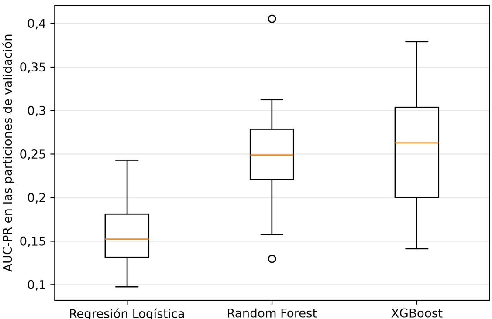

Fuente: Elaboración propia

La prueba t con varianza corregida indica que XGBoost supera a la Regresión Logística de forma significativa en AUC-PR (diferencia de 0,102; p = 0,012) y en F1 (0,126; p = 0,031) (Tabla 27). Random Forest la supera en AUC-PR (0,088; p = 0,009), pero no en F1 (0,104; p = 0,055). Entre los dos ensambles no hay diferencias significativas en ninguna métrica, con valores p que van de 0,103 a 0,552.

**Tabla 27. Prueba t pareada con varianza corregida en la validación cruzada del escenario base**

| Comparación | Métrica | Diferencia media | t corregida | Valor p | Tipo de prueba | Significativa |
|---|---|---|---|---|---|---|
| Random Forest - Regresión Logística | AUC-PR | 0,088 | 2,65 | 0,009 | Unilateral | Sí |
|  | F1 | 0,104 | 1,71 | 0,055 | Unilateral | No |
|  | AUC-ROC | 0,106 | 3,52 | 0,002 | Unilateral | Sí |
|  | Exhaustividad | 0,205 | 2,65 | 0,010 | Unilateral | Sí |
| XGBoost - Regresión Logística | AUC-PR | 0,102 | 2,55 | 0,012 | Unilateral | Sí |
|  | F1 | 0,126 | 2,03 | 0,031 | Unilateral | Sí |
|  | AUC-ROC | 0,144 | 4,76 | < 0,001 | Unilateral | Sí |
|  | Exhaustividad | 0,308 | 2,94 | 0,005 | Unilateral | Sí |
| Random Forest - XGBoost | AUC-PR | −0,014 | −0,61 | 0,552 | Bilateral | No |
|  | F1 | −0,023 | −0,80 | 0,438 | Bilateral | No |
|  | AUC-ROC | −0,037 | −1,74 | 0,103 | Bilateral | No |
|  | Exhaustividad | −0,103 | −1,52 | 0,150 | Bilateral | No |

Fuente: Elaboración propia

Nota. Catorce grados de libertad; nivel de significancia de 0,05.

Conjunto de prueba (2024). En los 20.054 contratos de 2024, con 1.522 alertas (7,59 %), los tres modelos obtienen un AUC-PR entre 3,2 y 3,6 veces la prevalencia (Tabla 28; Figuras 4 y 5). XGBoost vuelve a tener el mayor AUC-PR (0,274), el mayor F1 (0,331) y el mayor AUC-ROC (0,757). Sin embargo, las ventajas observadas en la validación cruzada no se confirman en el conjunto de prueba. Con los intervalos de confianza obtenidos por bootstrap por grupos de entidad, año y mes (362 grupos):

- XGBoost frente a la Regresión Logística. Las diferencias en AUC-PR (0,009), F1 (0,011) y AUC-ROC (0,016) no son significativas, porque los tres intervalos incluyen el cero. La única diferencia significativa es la exhaustividad, que es 0,151 mayor; a cambio, la precisión es 0,049 menor, una diferencia cuyo intervalo incluye el cero.

- Random Forest frente a la Regresión Logística. Sus diferencias en AUC-PR, F1 y AUC-ROC tampoco son significativas. La única diferencia significativa es una precisión menor (−0,078).

**Tabla 28. Desempeño en el conjunto de prueba (2024) con intervalos de confianza del 95 %**

| Modelo o diferencia | AUC-PR | F1 | Precisión | Exhaustividad | AUC-ROC |
|---|---|---|---|---|---|
| Regresión Logística | 0,265 [0,211; 0,332] | 0,321 [0,255; 0,394] | 0,297 [0,238; 0,362] | 0,349 [0,262; 0,455] | 0,741 [0,678; 0,793] |
| Random Forest | 0,240 [0,203; 0,298] | 0,293 [0,253; 0,339] | 0,219 [0,184; 0,268] | 0,444 [0,345; 0,552] | 0,721 [0,659; 0,780] |
| XGBoost | 0,274 [0,222; 0,348] | 0,331 [0,284; 0,389] | 0,248 [0,202; 0,311] | 0,500 [0,406; 0,596] | 0,757 [0,691; 0,816] |
| Random Forest - Regresión Logística | −0,025 [−0,085; 0,042] | −0,027 [−0,112; 0,043] | −0,078 [−0,139; −0,014] | 0,095 [−0,062; 0,223] | −0,020 [−0,085; 0,046] |
| XGBoost - Regresión Logística | 0,009 [−0,042; 0,068] | 0,011 [−0,041; 0,064] | −0,049 [−0,097; 0,005] | 0,151 [0,064; 0,235] | 0,016 [−0,055; 0,083] |

Fuente: Elaboración propia

Nota. Intervalos obtenidos por bootstrap pareado por grupos, con 2.000 remuestras de los 362 grupos de entidad, año y mes de firma del conjunto de prueba (sección 7.4.5). Prevalencia de alertas en prueba: 7,59 %.

**Figura 4. Curvas de precisión y exhaustividad en el conjunto de prueba (2024)**

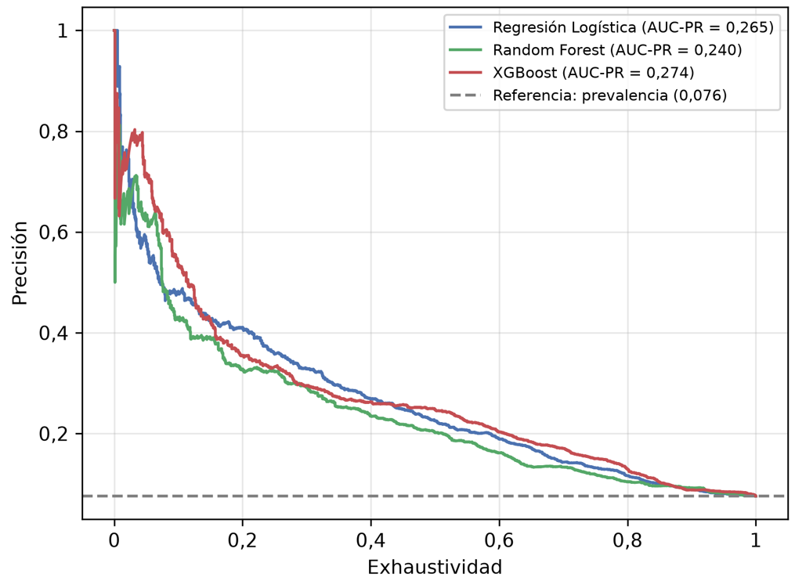

Fuente: Elaboración propia

**Figura 5. Curvas ROC en el conjunto de prueba (2024)**

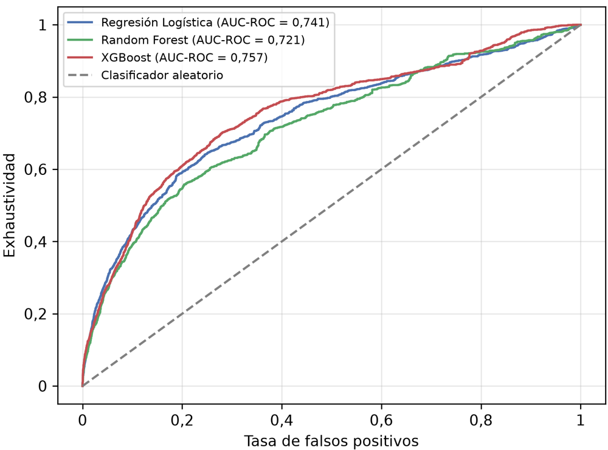

Fuente: Elaboración propia

Las matrices de confusión muestran el efecto práctico de estas diferencias (Figura 6). Con su umbral de decisión, XGBoost señala 3.073 contratos de 2024 e identifica 761 de las 1.522 alertas (50,0 %). La Regresión Logística señala 1.790 contratos e identifica 531 alertas (34,9 %), y Random Forest señala 3.088 e identifica 676 (44,4 %). Es decir, XGBoost recupera 230 alertas más que la Regresión Logística, pero señala 1.283 contratos más. La diferencia se debe sobre todo al umbral, ya que con la misma cantidad de contratos revisados, los dos modelos recuperan un número de alertas similar (sección 8.5).

**Figura 6. Matrices de confusión en el conjunto de prueba (2024)**

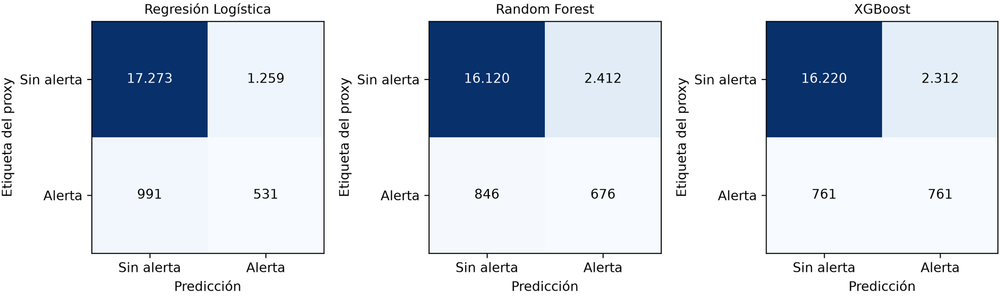

Fuente: Elaboración propia

El F1 estimado en la validación cruzada no resultó optimista para los modelos de ensamble, porque el de XGBoost fue de 0,330 en validación y 0,331 en prueba, y el de Random Forest de 0,308 y 0,293. La reducción de la ventaja en prueba se debe a que la Regresión Logística mejora, pues pasa de un AUC-PR de 0,158 en la validación cruzada a 0,265 en 2024, mientras que los ensambles se mantienen. Dos características de la etiqueta afectan más al conjunto de prueba, la subestimación de la regla de adiciones y el menor tiempo de observación de los contratos de 2024 (secciones 8.2.1 y 8.2.2). El escenario E11 permite descartar la primera como causa de la mejora. Sin esos contratos, la Regresión Logística mejora igual, de 0,170 a 0,285, aunque su exclusión sí aumenta la ventaja de los ensambles en 2024. La segunda no pudo comprobarse con los datos disponibles. Por tanto, la mejora de la Regresión Logística en prueba no tiene una explicación demostrada en este estudio y se reporta como limitación.

Escenarios de sensibilidad. Las Tablas 29 y 30 presentan el desempeño de los tres modelos en cada escenario del proxy, reentrenados con los hiperparámetros del escenario base (sección 7.4.1).

- AUC-PR en la validación cruzada. En todos los escenarios, los dos ensambles superan en promedio a la Regresión Logística. La diferencia va de 0,056 a 0,118 en Random Forest y de 0,070 a 0,129 en XGBoost.

- Comparación según el criterio de la sección 7.4.5, que exige una ventaja significativa a la vez en AUC-PR y en F1:

- XGBoost supera a la Regresión Logística en el escenario base y en E1, E2 y E3, pero no en E4, E8 ni E10. En E4 y E8, su ventaja en F1 no es significativa (p = 0,082 y p = 0,078). En E10, que tiene la menor prevalencia (2,89 %), la variabilidad entre particiones impide que la ventaja sea significativa incluso en AUC-PR (p = 0,115).

- Random Forest no supera a la Regresión Logística en el escenario base, y entre los escenarios que cuentan para la Hipótesis 1 solo lo hace en E2.

- En los escenarios E5 a E7 y E9, que no cuentan para la Hipótesis 1, XGBoost supera a la Regresión Logística, como en el escenario base, y Random Forest la supera en E5, E6 y E9.

- En E11, que tampoco cuenta para la Hipótesis 1, Random Forest supera a la Regresión Logística y XGBoost no, porque su ventaja en F1 no es significativa (p = 0,066).

La decisión sobre la Hipótesis 1 se presenta en la sección 8.6.

**Tabla 29. Desempeño en la validación cruzada y resultado de la comparación por escenario**

| Escenario | Prevalencia en entrenamiento (%) | AUC-PR RL | AUC-PR RF | AUC-PR XGB | F1 RL | F1 RF | F1 XGB | ¿RF supera a RL? | ¿XGB supera a RL? |
|---|---|---|---|---|---|---|---|---|---|
| E0 Base | 7,31 | 0,158 | 0,246 | 0,260 | 0,204 | 0,308 | 0,330 | No | Sí |
| E1 R1 ≥ 25 % | 9,47 | 0,208 | 0,294 | 0,337 | 0,256 | 0,353 | 0,380 | No | Sí |
| E2 R1 ≥ 50 % | 6,55 | 0,134 | 0,252 | 0,263 | 0,180 | 0,307 | 0,323 | Sí | Sí |
| E3 R2 ≥ 40 % | 9,57 | 0,174 | 0,231 | 0,271 | 0,216 | 0,291 | 0,355 | No | Sí |
| E4 R2 ≥ 70 % | 5,09 | 0,144 | 0,214 | 0,219 | 0,210 | 0,264 | 0,263 | No | No |
| E5 R3 ≥ 15 %* | 7,37 | 0,150 | 0,239 | 0,255 | 0,194 | 0,296 | 0,323 | Sí | Sí |
| E6 R3 mín. 10* | 7,32 | 0,158 | 0,246 | 0,258 | 0,205 | 0,310 | 0,327 | Sí | Sí |
| E7 R3 mín. 50* | 7,30 | 0,156 | 0,245 | 0,257 | 0,203 | 0,304 | 0,321 | No | Sí |
| E8 Sin régimen especial | 6,62 | 0,189 | 0,268 | 0,260 | 0,223 | 0,328 | 0,323 | No | No |
| E9 Sin COVID-19* | 7,34 | 0,171 | 0,264 | 0,282 | 0,216 | 0,334 | 0,344 | Sí | Sí |
| E10 Al menos dos reglas | 2,89 | 0,055 | 0,139 | 0,152 | 0,085 | 0,188 | 0,202 | No | No |
| E11 Solo con regla 1 activable* | 6,43 | 0,170 | 0,238 | 0,245 | 0,246 | 0,298 | 0,289 | Sí | No |

Fuente: Elaboración propia

Nota. RL: Regresión Logística; RF: Random Forest; XGB: XGBoost. Promedios en las quince particiones. Un ensamble supera a la RL cuando su ventaja es positiva y significativa (prueba t corregida, unilateral, α = 0,05) en AUC-PR y en F1. * Escenario que no cuenta para la decisión sobre la Hipótesis 1 (sección 7.4.5).

**Tabla 30. Desempeño en el conjunto de prueba (2024) por escenario**

| Escenario | Prevalencia en prueba (%) | AUC-PR RL | AUC-PR RF | AUC-PR XGB | F1 RL | F1 RF | F1 XGB |
|---|---|---|---|---|---|---|---|
| E0 Base | 7,59 | 0,265 | 0,240 | 0,274 | 0,321 | 0,293 | 0,331 |
| E1 R1 ≥ 25 % | 9,77 | 0,298 | 0,276 | 0,321 | 0,340 | 0,338 | 0,371 |
| E2 R1 ≥ 50 % | 6,46 | 0,235 | 0,203 | 0,240 | 0,310 | 0,245 | 0,290 |
| E3 R2 ≥ 40 % | 10,18 | 0,323 | 0,310 | 0,338 | 0,277 | 0,326 | 0,400 |
| E4 R2 ≥ 70 % | 5,97 | 0,261 | 0,251 | 0,271 | 0,298 | 0,280 | 0,296 |
| E5 R3 ≥ 15 % | 7,61 | 0,266 | 0,244 | 0,273 | 0,323 | 0,295 | 0,332 |
| E6 R3 mín. 10 | 7,61 | 0,265 | 0,240 | 0,276 | 0,318 | 0,303 | 0,336 |
| E7 R3 mín. 50 | 7,58 | 0,266 | 0,238 | 0,272 | 0,318 | 0,298 | 0,328 |
| E8 Sin régimen especial | 7,04 | 0,244 | 0,242 | 0,255 | 0,302 | 0,294 | 0,292 |
| E9 Sin COVID-19 | 7,59 | 0,266 | 0,246 | 0,280 | 0,320 | 0,304 | 0,337 |
| E10 Al menos dos reglas | 2,71 | 0,115 | 0,118 | 0,129 | 0,172 | 0,167 | 0,193 |
| E11 Solo con regla 1 activable | 7,83 | 0,285 | 0,306 | 0,322 | 0,330 | 0,320 | 0,334 |

Fuente: Elaboración propia

En el conjunto de prueba, XGBoost obtiene el mayor AUC-PR en los doce escenarios, y Random Forest el menor en diez de ellos. Las excepciones son E10 y E11, donde el menor es el de la Regresión Logística. En los escenarios E0 a E10, las diferencias entre XGBoost y la Regresión Logística son pequeñas y van de 0,006 a 0,023 en AUC-PR. En E11, en cambio, la diferencia es de 0,037, y Random Forest también supera a la Regresión Logística (0,306 frente a 0,285). Sin los contratos en los que la regla de adiciones no puede activarse, la ventaja de los ensambles en 2024 es mayor, aunque estas diferencias en prueba no se acompañan de intervalos de confianza. E11 no cuenta para la decisión sobre la Hipótesis 1 y, además, en la validación cruzada XGBoost no cumple allí el criterio.

Para responder al interrogante planteado en el capítulo 5, la Figura 7 relaciona la ventaja de cada ensamble en AUC-PR con la prevalencia de alertas del escenario. La ventaja absoluta no muestra una relación sistemática con la prevalencia. En XGBoost es de 0,097 en E10 (2,89 %), de 0,075 en E4 (5,09 %), de 0,129 en E2 (6,55 %) y de 0,128 en E1 (9,47 %). En términos relativos, en cambio, la ventaja es mayor cuando las alertas son más escasas. En E10, el AUC-PR de XGBoost es 2,7 veces el de la Regresión Logística, mientras que en los demás escenarios esa razón está entre 1,4 y 2,0.

**Figura 7. Ventaja de los ensambles sobre la Regresión Logística frente a la prevalencia de alertas por escenario**

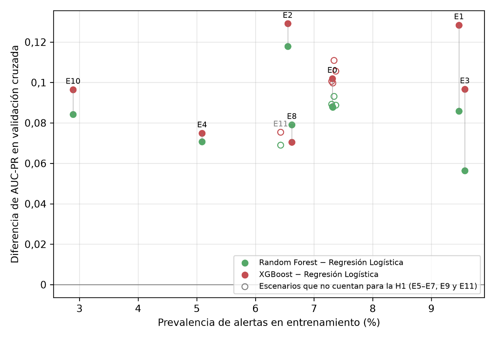

Fuente: Elaboración propia

Modelo sin valor ni plazo iniciales. Al excluir el valor y el plazo iniciales, el desempeño de los tres modelos baja (Tabla 31). En el conjunto de prueba, el AUC-PR de XGBoost cae de 0,274 a 0,179 (35 % menos), el de Random Forest de 0,240 a 0,180 y el de la Regresión Logística de 0,265 a 0,214. La pérdida indica que una parte importante de la capacidad predictiva se apoya en estas dos variables, que son los denominadores de las reglas de adición y prórroga (sección 4.3.2). Aun así, sin ellas XGBoost conserva un AUC-PR 2,4 veces superior a la prevalencia, lo que muestra una señal que no depende de esa relación aritmética. Sin el valor y el plazo, la Regresión Logística queda por encima de los dos ensambles en el conjunto de prueba.

**Tabla 31. Desempeño con y sin el valor y el plazo iniciales como predictores**

| Modelo | Métrica | Validación cruzada, con / sin | Diferencia (valor p) | Prueba 2024, con / sin |
|---|---|---|---|---|
| Regresión Logística | AUC-PR | 0,158 / 0,122 | 0,036 (< 0,001) | 0,265 / 0,214 |
|  | F1 | 0,204 / 0,179 | 0,025 (0,073) | 0,321 / 0,295 |
| Random Forest | AUC-PR | 0,246 / 0,178 | 0,068 (0,034) | 0,240 / 0,180 |
|  | F1 | 0,308 / 0,219 | 0,089 (0,164) | 0,293 / 0,219 |
| XGBoost | AUC-PR | 0,260 / 0,160 | 0,100 (0,073) | 0,274 / 0,179 |
|  | F1 | 0,330 / 0,220 | 0,110 (0,214) | 0,331 / 0,209 |

Fuente: Elaboración propia

Nota. Valor p de la prueba t corregida, bilateral.

### 8.3.3 Selección del Modelo Óptimo

Según el criterio de la sección 7.4.5, el modelo que se analiza con valores SHAP es el de mayor AUC-PR promedio en la validación cruzada del escenario base, que es XGBoost, con 0,260, frente a 0,246 de Random Forest. La diferencia entre los dos no es significativa (p = 0,552, bilateral), por lo que se conserva XGBoost y se informa que su superioridad sobre Random Forest no es concluyente. La elección es coherente con los demás resultados:

- XGBoost tiene el mayor promedio en la validación cruzada en todas las métricas, excepto la precisión.

- Es el único ensamble que supera de forma significativa a la Regresión Logística en el escenario base.

- Obtiene el mayor AUC-PR en el conjunto de prueba en los doce escenarios.

En cuanto a si el bagging o el boosting resulta más adecuado (sección 4.3.4), ninguna diferencia entre Random Forest y XGBoost es significativa en la validación cruzada (Tabla 27). Como análisis complementario, no previsto en la sección 7.4.5, la diferencia pareada en el conjunto de prueba, obtenida con las mismas remuestras del bootstrap, favorece a XGBoost en AUC-PR (0,034 [0,003; 0,069]) y en F1 (0,038 [0,002; 0,089]). La evidencia a favor del boosting es, por tanto, parcial: aparece en 2024, pero no se confirma entre las particiones de entrenamiento.

El modelo seleccionado combina 676 árboles de cuatro niveles, con una tasa de aprendizaje de 0,059 (Tabla 25). Con su umbral de 0,483, en el conjunto de prueba identifica la mitad de las alertas, con una precisión de 0,248, es decir, aproximadamente uno de cada cuatro contratos que señala tiene alerta según el proxy. Sus predicciones se analizan con valores SHAP en la sección 8.4.

## 8.4 Interpretabilidad Algorítmica con Valores SHAP (XAI)

### 8.4.1 Importancia Global de los Factores Asociados

Los valores SHAP del modelo seleccionado, XGBoost, se calcularon con TreeExplainer para los 20.054 contratos del conjunto de prueba (2024), en la escala del logaritmo de la razón de momios (log-odds). Se sumaron las contribuciones de las columnas de cada descriptor categórico (sección 7.4.6), y se comprobó la propiedad de aditividad. En cada contrato, el valor base del modelo más la suma de las contribuciones de sus doce descriptores reproduce su puntaje.

La Tabla 32 y la Figura 8 presentan la importancia global de los doce descriptores. Tres descriptores concentran el 60,1 % de la importancia total: el valor inicial (20,9 %), el mes de suscripción (20,7 %) y el plazo inicial (18,4 %). Les siguen la cercanía a la Ley de Garantías (9,8 %) y el sector de la entidad (9,2 %). Entre los dos, el valor y el plazo iniciales reúnen el 39,3 % de la importancia. Como están correlacionados y son los denominadores de las reglas de adición y prórroga, su peso se interpreta en conjunto y se contrasta con el modelo que los excluye (sección 8.4.2). En el otro extremo, el tamaño del proveedor apenas contribuye (0,2 %).

**Tabla 32. Importancia global de los descriptores y estabilidad de su posición en la validación cruzada**

| Posición en prueba | Descriptor | Contribución media absoluta (log-odds) | % de la importancia total | Posición media en las particiones (mín. – máx.) | % de particiones entre los cinco primeros |
|---|---|---|---|---|---|
| 1 | Valor inicial | 0,803 | 20,9 | 1,9 (1 – 3) | 100,0 |
| 2 | Mes de suscripción | 0,796 | 20,7 | 2,2 (1 – 3) | 100,0 |
| 3 | Plazo inicial | 0,706 | 18,4 | 1,9 (1 – 3) | 100,0 |
| 4 | Cercanía a la Ley de Garantías | 0,374 | 9,8 | 5,4 (4 – 7) | 53,3 |
| 5 | Sector de la entidad | 0,354 | 9,2 | 4,5 (4 – 7) | 93,3 |
| 6 | Antigüedad del proveedor | 0,252 | 6,6 | 5,5 (4 – 6) | 40,0 |
| 7 | Modalidad de selección | 0,154 | 4,0 | 7,5 (6 – 8) | 0,0 |
| 8 | Causal de contratación directa | 0,141 | 3,7 | 7,5 (4 – 10) | 13,3 |
| 9 | Naturaleza jurídica (persona natural) | 0,134 | 3,5 | 8,7 (8 – 10) | 0,0 |
| 10 | Categoría del bien o servicio | 0,081 | 2,1 | 10,1 (9 – 11) | 0,0 |
| 11 | Tipo de contrato | 0,035 | 0,9 | 10,7 (9 – 11) | 0,0 |
| 12 | Tamaño del proveedor (pyme) | 0,007 | 0,2 | 12,0 (12 – 12) | 0,0 |

Fuente: Elaboración propia

Nota. La importancia se calcula sobre los 20.054 contratos de prueba (2024). La posición en las particiones se obtiene al entrenar el modelo en cada una de las quince particiones de la validación cruzada y calcular los valores SHAP sobre su parte de validación (sección 7.4.6).

**Figura 8. Importancia global de los descriptores en el conjunto de prueba (2024)**

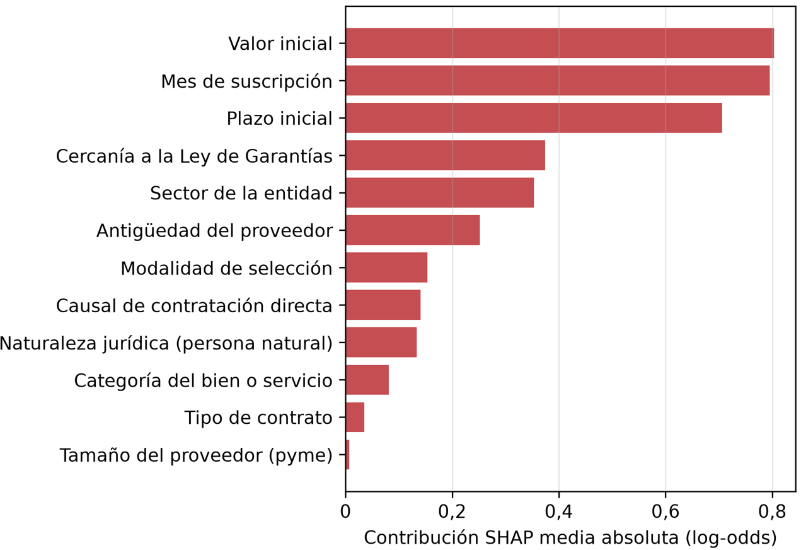

Fuente: Elaboración propia

La importancia de la cercanía a la Ley de Garantías requiere una precisión. En 2024 no hubo elecciones, por lo que los 20.054 contratos de prueba están fuera de las ventanas de la Ley de Garantías. En el entrenamiento, en cambio, el 52 % de los contratos de 2021–2023 se firmó antes, durante o después de las restricciones de las elecciones de 2022 y 2023. El modelo aprendió de esos periodos y, al no encontrarlos en 2024, asigna a casi todos los contratos de prueba una contribución negativa de este descriptor (−0,37 en promedio). Su importancia en prueba funciona, por tanto, como un ajuste del puntaje para un año sin elecciones y no como un factor que diferencie entre los contratos de 2024. Por la misma razón, su dirección no puede observarse en ese conjunto (sección 8.4.2).

Estabilidad del orden de importancia. El orden de los descriptores se mantiene en las quince particiones de la validación cruzada (Figura 9). El coeficiente W de Kendall entre los quince ordenamientos es de 0,945, superior al umbral de 0,7 fijado en la sección 7.4.6. El valor inicial, el plazo inicial y el mes de suscripción ocupan las tres primeras posiciones en todas las particiones, aunque se alternan entre ellas. El sector de la entidad está entre los cinco primeros en el 93,3 % de las particiones, y la cercanía a la Ley de Garantías y la antigüedad del proveedor, que se disputan las posiciones cuarta a séptima, en el 53,3 % y el 40,0 %. Los seis descriptores restantes no aparecen entre los cinco primeros, salvo la causal de contratación directa en dos particiones. El tamaño del proveedor es el último en todas.

**Figura 9. Posición de cada descriptor en el orden de importancia en las quince particiones de la validación cruzada**

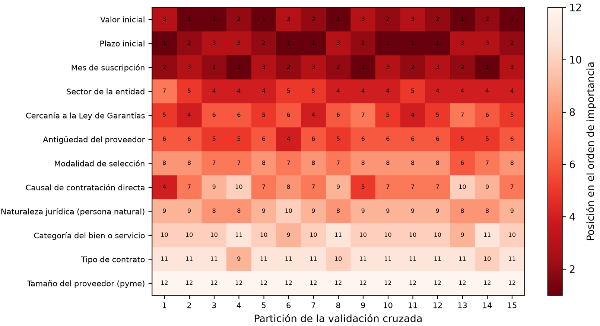

Fuente: Elaboración propia

### 8.4.2 Dirección del Efecto de los Factores Asociados

Descriptores numéricos. La Figura 10 muestra cómo varía la contribución SHAP a lo largo de los valores de los tres descriptores numéricos.

- Valor inicial. Su contribución aumenta con el valor del contrato. Es la relación más clara del modelo, con una correlación de Spearman entre el valor y su contribución es de 0,875. Los contratos de menos de $10 millones reciben contribuciones entre −1 y −3. Entre $15 y $50 millones la contribución es cercana a cero. Por encima de $100 millones es positiva, y alcanza valores cercanos a +2 en los contratos de más de $1.000 millones. Esta forma coincide con la proporción de alertas en el entrenamiento, que pasa del 4,6 % en los contratos de hasta $10 millones al 31,4 % en los de más de $1.000 millones.

- Plazo inicial. La relación no es lineal. Los plazos de entre 30 y 200 días reciben contribuciones cercanas a cero o positivas, con máximos alrededor de 120 y 180 días. Por encima de 210 días la contribución se vuelve negativa y llega a valores entre −3 y −3,5 en los contratos de 300 a 360 días. La correlación de Spearman es negativa pero débil (−0,199). En promedio, los plazos más cortos aumentan el puntaje. Sin embargo, la diferencia principal está entre los contratos de menos de siete meses y los cercanos a un año. Esta forma es compatible con la relación aritmética de la regla de prórroga (sección 4.3.2), porque un contrato de casi un año necesita una prórroga de más de seis meses para alcanzar el umbral del 50 %.

- Antigüedad del proveedor. Los proveedores con menos de unos 400 días de registro reciben contribuciones negativas, de hasta −1. La contribución crece hasta un máximo entre 900 y 1.100 días y se mantiene cerca de cero o ligeramente positiva en los proveedores más antiguos. La correlación de Spearman es positiva (0,489). En el modelo, la mayor antigüedad aumenta el puntaje.

**Figura 10. Contribución SHAP según el valor inicial, el plazo inicial y la antigüedad del proveedor (conjunto de prueba, 2024)**

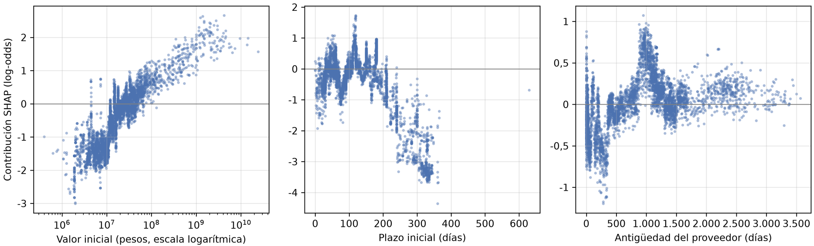

Fuente: Elaboración propia

Descriptores categóricos. La Figura 11 presenta la contribución media de cada categoría.

- Mes de suscripción. Los contratos firmados de enero a marzo reciben contribuciones positivas: +0,69 en enero, +0,46 en febrero y +0,30 en marzo. Los de abril a diciembre reciben contribuciones negativas, la más baja en julio (−1,57). Diciembre (−0,78) no se diferencia de los demás meses del segundo semestre.

- Modalidad de selección. La contratación competitiva tiene una contribución de +1,56, frente a −0,11 en la directa y −0,20 en el régimen especial. En la causal de contratación directa se observa lo mismo, pues los servicios profesionales y de apoyo a la gestión reducen el puntaje (−0,10), y los contratos a los que no aplica la causal, es decir, los no directos, lo aumentan (+0,32).

- Naturaleza jurídica. Los contratos con personas jurídicas reciben una contribución de +0,25, frente a −0,12 en los celebrados con personas naturales.

- Sector de la entidad. Las contribuciones más altas corresponden a Vivienda, Ciudad y Territorio (+1,59) y Transporte (+0,79). La más baja es la de Ambiente y Desarrollo Sostenible (−0,86). Servicio Público, que reúne el 61,0 % de los contratos de prueba, tiene una contribución de −0,18.

- Categoría del bien o servicio y tipo de contrato. Sus contribuciones son menores y de signo variable. En el tamaño del proveedor, la diferencia entre categorías es inferior a 0,02.

**Figura 11. Contribución SHAP media por categoría de los descriptores categóricos (conjunto de prueba, 2024)**

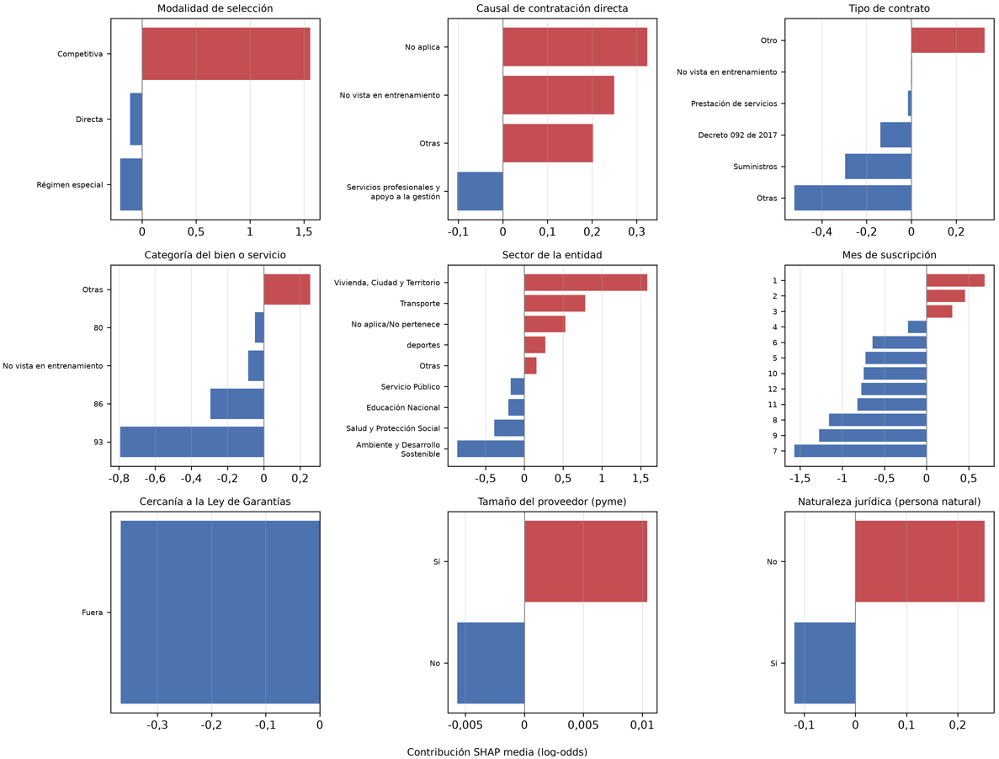

Fuente: Elaboración propia

Las direcciones de la modalidad de selección y de la naturaleza jurídica son contrarias a las esperadas en la sección 4.3.3, y reproducen la distribución de la etiqueta descrita en la sección 8.2.1. Allí, la proporción de alertas es mucho mayor en la contratación competitiva, donde predominan los contratos de obra, suministro y compraventa. La subestimación de la regla de adiciones también actúa en ese sentido, porque se concentra en la contratación directa de prestación de servicios (sección 8.2.1). Sin embargo, no basta para explicar la inversión. Aun si se sumaran las 610 a 860 alertas estimadas, la proporción en la contratación directa seguiría cerca del 7 %, frente al 38,5 % en la competitiva. Ninguno de estos dos descriptores está entre los cinco más importantes, por lo que no intervienen en el criterio de consistencia de la Hipótesis 2. Se retoman en la Discusión.

Consistencia con la literatura. La Tabla 33 aplica el criterio fijado en la sección 7.4.6 a los cinco descriptores de mayor importancia. En el modelo base hay tres descriptores evaluables:

- El valor inicial muestra la dirección esperada.

- El plazo inicial también la muestra.

- El mes de suscripción no la muestra: los contratos de diciembre reciben, en promedio, una contribución menor que los de los demás meses (−0,78 frente a −0,51).

La cercanía a la Ley de Garantías no es evaluable, porque en 2024 no hay contratos antes ni después de las restricciones. El sector de la entidad no tiene una dirección esperada. Dos de los tres descriptores evaluables coinciden con la literatura, por lo que el criterio de consistencia se cumple en el modelo base.

**Tabla 33. Dirección observada de los cinco descriptores de mayor importancia frente a la dirección esperada**

| Modelo | Posición | Descriptor | Dirección esperada (sección 4.3.3) | Resultado observado en prueba | ¿Coincide? |
|---|---|---|---|---|---|
| Base | 1 | Valor inicial | Mayor alerta en valores altos e intermedios | Spearman = 0,875 | Sí |
|  | 2 | Mes de suscripción | Mayor alerta en diciembre | Diciembre: −0,78; resto: −0,51 | No |
|  | 3 | Plazo inicial | Mayor alerta en plazos cortos | Spearman = −0,199 | Sí |
|  | 4 | Cercanía a la Ley de Garantías | Mayor alerta antes y después de la restricción | Sin contratos antes ni después en 2024 | No evaluable |
|  | 5 | Sector de la entidad | Sin dirección esperada | - | - |
| Sin valor ni plazo iniciales | 1 | Mes de suscripción | Mayor alerta en diciembre | Diciembre: −1,71; resto: −0,54 | No |
|  | 2 | Antigüedad del proveedor | Mayor alerta en proveedores recientes | Spearman = 0,656 | No |
|  | 3 | Sector de la entidad | Sin dirección esperada | - | - |
|  | 4 | Cercanía a la Ley de Garantías | Mayor alerta antes y después de la restricción | Sin contratos antes ni después en 2024 | No evaluable |
|  | 5 | Naturaleza jurídica (persona natural) | Mayor alerta en personas naturales | Persona natural: −0,24; resto: +0,69 | No |

Fuente: Elaboración propia

Nota. Para los descriptores numéricos se informa la correlación de Spearman entre el valor del descriptor y su contribución SHAP (p < 0,001 en todos los casos). Para los categóricos se informa la contribución SHAP media, en log-odds, de la categoría señalada y del resto. La antigüedad del proveedor se calcula sobre los 19.885 contratos de prueba con ese dato.

En el modelo que excluye el valor y el plazo iniciales, la importancia se redistribuye (Figura 12). El mes de suscripción pasa al primer lugar, seguido de la antigüedad del proveedor, el sector de la entidad, la cercanía a la Ley de Garantías y la naturaleza jurídica. En ese modelo, ninguno de los tres descriptores evaluables muestra la dirección esperada (Tabla 33). Así, la consistencia con la literatura del modelo base depende del valor y el plazo iniciales, cuya dirección puede reflejar, al menos en parte, su relación aritmética con las reglas del proxy. Como se estableció en la sección 7.4.6, este resultado no cambia el criterio de la Hipótesis 2, pero se reporta como limitación en la sección 8.6.

**Figura 12. Importancia global de los descriptores en el modelo sin valor ni plazo iniciales (conjunto de prueba, 2024)**

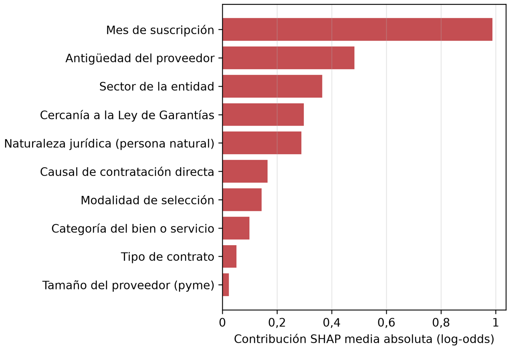

Fuente: Elaboración propia

### 8.4.3 Trazabilidad Local en Casos de Estudio

De los contratos de prueba con alerta se seleccionaron al azar, con semilla fija, quince casos: cinco que solo cumplen la regla de adiciones, cinco que solo cumplen la de prórrogas y cinco que cumplen ambas (sección 7.4.6). La Tabla 34 resume para cada uno su puntaje y las tres contribuciones de mayor magnitud. La Figura 13 presenta, como ejemplo, el desglose completo de uno de ellos. Los desgloses de los quince contratos se presentan en el Anexo A (capítulo 12). En todos, el valor base del modelo (0,028 en log-odds, equivalente a un puntaje de 0,507) más la suma de las contribuciones reproduce el puntaje del contrato. El valor base es cercano a 0,5 porque los pesos de clase equilibran la influencia de las dos clases durante el entrenamiento (sección 7.4.4).

**Tabla 34. Explicaciones locales de quince contratos de prueba con alerta**

| Código | Reglas que cumple | Puntaje | ¿Supera el umbral? | Tres contribuciones de mayor magnitud (log-odds) |
|---|---|---|---|---|
| C01 | Solo adiciones | 0,506 | Sí | Modalidad competitiva (+1,43); mes 12 (−0,68); plazo de 10 días (−0,68) |
| C02 | Solo adiciones | 0,148 | No | Sector Salud y Protección Social (−0,56); mes 12 (−0,51); fuera de la Ley de Garantías (−0,42) |
| C03 | Solo adiciones | 0,036 | No | Valor de $6,0 millones (−1,78); fuera de la Ley de Garantías (−0,68); sector Servicio Público (−0,29) |
| C04 | Solo adiciones | 0,754 | Sí | Sector no aplica (+1,22); plazo de 210 días (−0,21); causal de servicios profesionales (−0,14) |
| C05 | Solo adiciones | 0,891 | Sí | Sector Vivienda, Ciudad y Territorio (+1,76); plazo de 150 días (+0,66); fuera de la Ley de Garantías (−0,54) |
| C06 | Solo prórrogas | 0,025 | No | Valor de $5,5 millones (−1,63); mes 10 (−0,83); fuera de la Ley de Garantías (−0,69) |
| C07 | Solo prórrogas | 0,019 | No | Valor de $5,5 millones (−1,74); mes 10 (−0,80); fuera de la Ley de Garantías (−0,66) |
| C08 | Solo prórrogas | 0,971 | Sí | Valor de $4.060 millones (+1,98); modalidad competitiva (+1,75); plazo de 90 días (−0,49) |
| C09 | Solo prórrogas | 0,033 | No | Valor de $9,0 millones (−1,70); fuera de la Ley de Garantías (−0,66); antigüedad de 1 día (−0,41) |
| C10 | Solo prórrogas | 0,321 | No | Mes 10 (−0,82); valor de $33,6 millones (+0,69); sector Ambiente y Desarrollo Sostenible (−0,52) |
| C11 | Adiciones y prórrogas | 0,711 | Sí | Mes 3 (+0,90); antigüedad de 802 días (+0,20); modalidad directa (−0,13) |
| C12 | Adiciones y prórrogas | 0,224 | No | Antigüedad de 319 días (−1,16); mes 2 (+0,26); plazo de 176 días (+0,16) |
| C13 | Adiciones y prórrogas | 0,104 | No | Mes 8 (−1,02); fuera de la Ley de Garantías (−0,38); plazo de 90 días (−0,24) |
| C14 | Adiciones y prórrogas | 0,137 | No | Valor de $6,8 millones (−1,28); fuera de la Ley de Garantías (−0,49); plazo de 120 días (+0,44) |
| C15 | Adiciones y prórrogas | 0,942 | Sí | Valor de $1.000 millones (+1,79); plazo de 180 días (+0,36); tipo de contrato Otro (+0,33) |

Fuente: Elaboración propia

Nota. Contratos de 2024 identificados con un código interno, sin datos del contratista ni de la entidad (sección 7.4.7). Umbral de decisión: 0,483 (Tabla 26).

**Figura 13. Desglose del puntaje de un contrato de prueba con alerta (caso C08)**

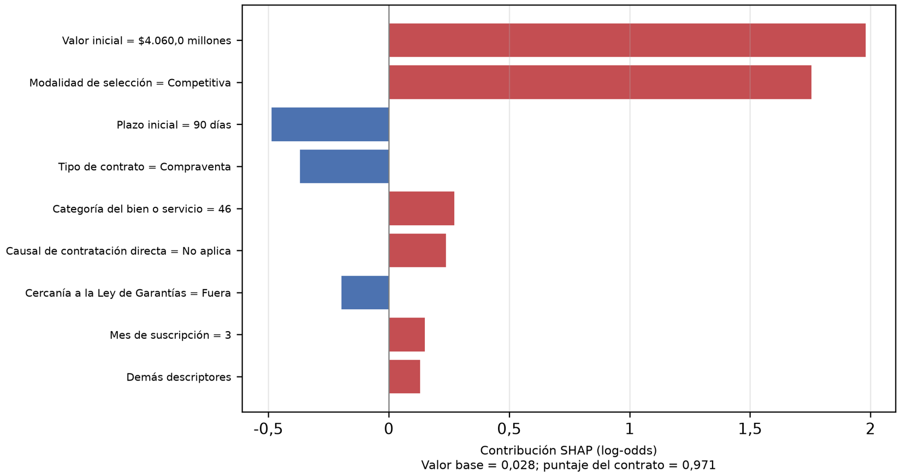

Fuente: Elaboración propia

Con su umbral de decisión, el modelo señala seis de los quince contratos: tres de los cinco que solo cumplen la regla de adiciones, uno de los cinco que solo cumplen la de prórrogas y dos de los cinco que cumplen ambas. Los casos ilustran los patrones de la sección 8.4.2:

- Contratos señalados. Su puntaje se explica sobre todo por un valor alto (C08 y C15), por la modalidad competitiva (C01 y C08), por el sector de la entidad (C04 y C05) o por la firma en el primer trimestre (C11).

- Contratos no señalados. En cinco de los nueve, la contribución de mayor magnitud es la del valor inicial, inferior a $10 millones (C03, C06, C07, C09 y C14). Estos casos muestran el principal límite del modelo. Las alertas en contratos de bajo valor, que son la mayoría de la población, reciben puntajes bajos.

- Ley de Garantías. La contribución negativa aparece entre las tres principales en ocho de los quince casos, como un descuento común a todos los contratos de 2024 (sección 8.4.1).

Para una contraloría, este desglose permite conocer, en cada contrato señalado, qué características llevaron a su priorización, que es la trazabilidad técnica planteada en el Objetivo Específico 4. Su uso dentro del marco de priorización se presenta en la sección 8.5.

## 8.5 Marco de Priorización como Propuesta de Solución

Esta sección responde a la segunda parte del Objetivo Específico 4, que consiste en traducir los puntajes del modelo en un esquema de priorización de contratos para el control fiscal territorial. Primero se evalúa el ordenamiento según la capacidad de revisión y luego se presenta el esquema operativo que resulta de él.

### 8.5.1 Desempeño de la Priorización según la Capacidad de Revisión

La Tabla 35 presenta el resultado de ordenar los 20.054 contratos de 2024 según el puntaje del modelo y revisar el 5 %, el 10 % o el 20 % de ellos (sección 7.4.8). Si una contraloría revisara 1.003 contratos (el 5 %) elegidos al azar, encontraría en promedio 76 alertas. Si revisara los 1.003 de mayor puntaje según XGBoost, encontraría 345, con una precisión de 0,344, es decir, 4,5 veces la prevalencia.

Con mayor capacidad, el modelo encuentra más alertas, pero con menor precisión:

- Capacidad del 10 %: encuentra 539 alertas en 2.006 contratos, el 35,4 % de todas las alertas del año.

- Capacidad del 20 %: encuentra 875 alertas en 4.011 contratos, el 57,5 % del total.

La precisión baja porque los contratos que se agregan tienen puntajes cada vez menores. Aun así, en las tres capacidades es entre 2,9 y 4,5 veces mayor que la de una selección al azar.

**Tabla 35. Resultados de la priorización en el conjunto de prueba (2024) según la capacidad de revisión**

| Capacidad (contratos revisados) | Modelo | Alertas encontradas | Precisión | Exhaustividad | Precisión / prevalencia |
|---|---|---|---|---|---|
| 5 % (1.003) | XGBoost | 345 | 0,344 [0,261; 0,448] | 0,227 [0,171; 0,301] | 4,5 |
|  | Regresión Logística | 367 | 0,366 [0,277; 0,469] | 0,241 [0,182; 0,302] | 4,8 |
|  | Selección al azar | 76 | 0,076 | 0,050 | 1,0 |
| 10 % (2.006) | XGBoost | 539 | 0,269 [0,221; 0,334] | 0,354 [0,289; 0,444] | 3,5 |
|  | Regresión Logística | 572 | 0,285 [0,223; 0,369] | 0,376 [0,301; 0,453] | 3,8 |
|  | Selección al azar | 152 | 0,076 | 0,100 | 1,0 |
| 20 % (4.011) | XGBoost | 875 | 0,218 [0,174; 0,270] | 0,575 [0,486; 0,656] | 2,9 |
|  | Regresión Logística | 831 | 0,207 [0,163; 0,264] | 0,546 [0,467; 0,630] | 2,7 |
|  | Selección al azar | 304 | 0,076 | 0,200 | 1,0 |

Fuente: Elaboración propia

Nota. 20.054 contratos de prueba con 1.522 alertas (prevalencia del 7,59 %). Entre corchetes, intervalos de confianza del 95 % obtenidos por bootstrap pareado por grupos (sección 7.4.5). Para la selección al azar se informan los valores esperados.

Con la misma cantidad de contratos revisados, XGBoost y la Regresión Logística encuentran un número similar de alertas (Figura 14):

- La Regresión Logística encuentra 22 alertas más con la capacidad del 5 % y 33 más con la del 10 %.

- XGBoost encuentra 44 más con la del 20 %.

- Las curvas de los dos modelos se cruzan cerca del 13 %.

- Ninguna diferencia es significativa. Los intervalos de la diferencia en precisión son [−0,135; 0,094] con el 5 %, [−0,083; 0,043] con el 10 % y [−0,015; 0,030] con el 20 %.

Este resultado precisa lo observado en la sección 8.3.2. La mayor exhaustividad de XGBoost con su umbral de decisión se debe a que ese umbral señala más contratos, y no a una diferencia demostrada en la capacidad de ordenar los contratos.

Las precisiones se miden frente al proxy. Como la etiqueta subestima la regla de adiciones (sección 8.2.1), algunos contratos priorizados que cuentan como sin alerta podrían tenerla, por lo que la precisión observada puede ser algo inferior a la que se obtendría con una etiqueta completa.

**Figura 14. Precisión y exhaustividad según el porcentaje de contratos revisados (conjunto de prueba, 2024)**

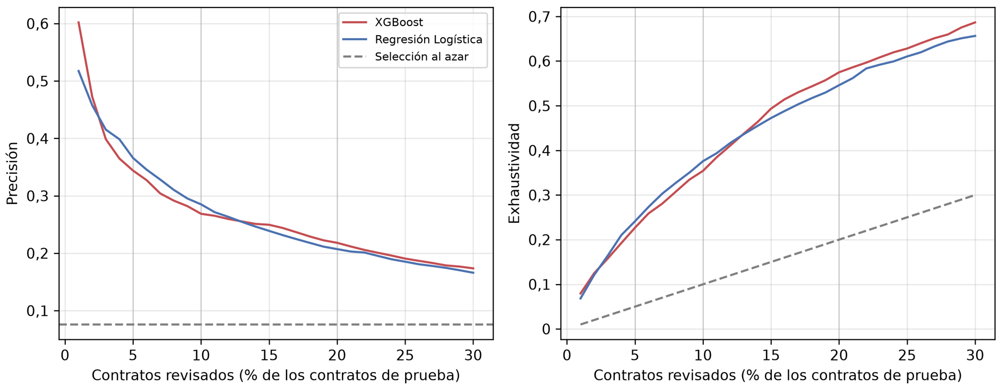

Fuente: Elaboración propia

Priorización por grupo de vigilancia. Cada contraloría vigila solo las entidades de su jurisdicción, por lo que el ordenamiento también se evaluó dentro de cada grupo de vigilancia (Tabla 36). En los cuatro grupos, la precisión de los dos modelos supera la prevalencia en las tres capacidades. Si cada contraloría revisara el 10 % de sus propios contratos, entre todas encontrarían 522 alertas con XGBoost, frente a 539 con un único ordenamiento de todo el departamento. Repartir la revisión entre las jurisdicciones apenas reduce el número de alertas encontradas.

Los resultados varían entre grupos:

- Departamento y otros municipios. Los dos modelos obtienen resultados casi iguales.

- Distrito de Barranquilla. La Regresión Logística logra una precisión mayor con la capacidad del 5 % (0,426 frente a 0,304), pero la diferencia no es significativa.

- Municipio de Soledad. Tiene la prevalencia más baja (4,69 %) y la menor precisión. Con la capacidad del 20 %, la precisión de XGBoost es de 0,079, 1,7 veces la prevalencia.

- Área Metropolitana de Barranquilla. Tiene la prevalencia más alta (30,48 %), y XGBoost alcanza precisiones de entre 0,69 y 0,86. Es el único caso con una diferencia significativa entre los dos modelos. Con la capacidad del 20 %, XGBoost supera a la Regresión Logística en 0,149 de precisión [0,029; 0,312] y en 0,099 de exhaustividad [0,022; 0,214]. Este resultado se basa en solo 87 contratos revisados y es una de 24 comparaciones (cuatro grupos, tres capacidades y dos medidas), por lo que podría deberse al azar.

**Tabla 36. Resultados de la priorización por grupo de vigilancia (conjunto de prueba, 2024)**

| Grupo de vigilancia (contratos; prevalencia) | Capacidad (revisados) | Precisión XGBoost | Precisión Regresión Logística | Exhaustividad XGBoost | Exhaustividad Regresión Logística |
|---|---|---|---|---|---|
| Departamento y otros municipios (6.411; 6,94 %) | 5 % (321) | 0,336 | 0,308 | 0,243 | 0,223 |
|  | 10 % (642) | 0,256 | 0,256 | 0,369 | 0,369 |
|  | 20 % (1.283) | 0,182 | 0,191 | 0,524 | 0,551 |
| Distrito de Barranquilla (11.119; 7,62 %) | 5 % (556) | 0,304 | 0,426 | 0,200 | 0,280 |
|  | 10 % (1.112) | 0,262 | 0,302 | 0,344 | 0,397 |
|  | 20 % (2.224) | 0,232 | 0,212 | 0,608 | 0,556 |
| Municipio de Soledad (2.091; 4,69 %) | 5 % (105) | 0,181 | 0,219 | 0,194 | 0,235 |
|  | 10 % (210) | 0,138 | 0,162 | 0,296 | 0,347 |
|  | 20 % (419) | 0,079 | 0,119 | 0,337 | 0,510 |
| Área Metropolitana de Barranquilla (433; 30,48 %) | 5 % (22) | 0,773 | 0,545 | 0,129 | 0,091 |
|  | 10 % (44) | 0,864 | 0,568 | 0,288 | 0,189 |
|  | 20 % (87) | 0,690* | 0,540 | 0,455* | 0,356 |

Fuente: Elaboración propia

Nota. La capacidad se aplica a los contratos de cada grupo. * Diferencia significativa frente a la Regresión Logística (el intervalo de confianza del 95 %, obtenido por bootstrap pareado por grupos, no incluye el cero). Las demás diferencias no son significativas.

### 8.5.2 Esquema Operativo de Alertas Tempranas

El procedimiento aplicado en este trabajo al conjunto de prueba (2024) constituye el esquema operativo que se propone. Tiene cuatro pasos, cada uno ejecutado y evaluado en las secciones anteriores.

- Cálculo del puntaje. A cada contrato se le asigna un puntaje con los doce descriptores de la Tabla 3. Como corresponden a información disponible al momento de la firma, la alerta puede anticiparse antes de que ocurran las adiciones y prórrogas que la originan (sección 4.3.2).

- Ordenamiento por jurisdicción. Los contratos de cada grupo de vigilancia se ordenan de mayor a menor puntaje (Tabla 36).

- Selección según la capacidad de revisión. Cada contraloría selecciona los primeros contratos del ordenamiento hasta completar su capacidad. Las Tablas 35 y 36 muestran lo observado en 2024 para cada capacidad. Con el 10 % de los contratos se encontró cerca de un tercio de las alertas, y con el 20 %, algo más de la mitad.

- Explicación de cada contrato seleccionado. Cada contrato seleccionado se acompaña del desglose de su puntaje en las contribuciones de sus descriptores, que en la Regresión Logística se obtienen de sus coeficientes y en XGBoost de los valores SHAP (sección 8.4.3; Figura 13 y Anexo A, capítulo 12). Así, el auditor puede conocer qué características llevaron a su priorización.

El esquema puede aplicarse con cualquiera de los dos modelos evaluados, porque con la misma capacidad de revisión ordenan los contratos con resultados similares y ninguna diferencia en la priorización de todo el departamento es significativa (sección 8.5.1). La Regresión Logística es la opción más simple. Su puntaje se obtiene con una combinación lineal de los descriptores, sus coeficientes se interpretan directamente y su ajuste requiere menos cómputo, de modo que es adecuada para una contraloría que empiece a usar el esquema. XGBoost, el modelo seleccionado según el criterio de la sección 7.4.5, es la opción cuando se quiere el desglose de cada contrato con valores SHAP, que en este trabajo se calculó y verificó para ese modelo (sección 8.4.3). Además, con la capacidad del 20 % encontró algo más de alertas, aunque la diferencia no es significativa. En ambos casos, los pasos del esquema son los mismos.

El esquema analítico se ejecutó de forma retrospectiva sobre los contratos de 2024, en el equipo descrito en la sección 7.3.2 y con software de código abierto, y su adopción por una contraloría no se evaluó en este trabajo. El entrenamiento y la evaluación de los modelos tomaron 32,9 minutos (sección 8.3.1), el cálculo de las explicaciones 0,6 minutos y el de la priorización 0,7 minutos, y estos tiempos no incluyen la descarga de los datos. Su aplicación no exige infraestructura de cómputo ni software propietario, condición relevante para contralorías sujetas a los límites de gasto de la Ley 617 de 2000.

El esquema orienta la selección de los contratos que serán objeto de vigilancia dentro del control posterior y selectivo, y no reemplaza el criterio del auditor. Una alerta no implica la existencia de una irregularidad (sección 7.4.7), y cualquier contrato priorizado debe seguir el proceso auditor ordinario de la contraloría competente.

## 8.6 Validación de las Hipótesis

Esta sección contrasta las dos hipótesis con las reglas de decisión fijadas antes de entrenar los modelos y de calcular los valores SHAP (secciones 7.4.5 y 7.4.6).

Hipótesis 1. La hipótesis plantea que los modelos de ensamble basados en árboles presentan un mejor desempeño que la Regresión Logística, medido con el F1 y el AUC-PR, bajo los distintos umbrales del proxy. Según la regla de la sección 7.4.5, un ensamble la cumple cuando cumple dos condiciones:

- Supera de forma significativa a la Regresión Logística, a la vez en AUC-PR y en F1, en el escenario base.

- La supera de la misma forma en al menos cuatro de los seis escenarios que modifican la etiqueta de forma material.

Ninguno de los dos ensambles cumple la hipótesis:

- Random Forest. No supera a la Regresión Logística en el escenario base, porque su ventaja en F1 no es significativa (p = 0,055). Entre los seis escenarios, solo la supera en E2.

- XGBoost. La supera en el escenario base y en E1, E2 y E3, pero no en E4, E8 ni E10 (Tabla 29). Alcanza tres de los cuatro escenarios requeridos.

En consecuencia, la Hipótesis 1 se rechaza.

El rechazo no significa que los ensambles tengan un desempeño inferior. En la validación cruzada, ambos obtienen en promedio un AUC-PR mayor que el de la Regresión Logística en todos los escenarios (Tabla 29). Sin embargo, esa ventaja no es lo bastante consistente entre particiones como para ser significativa a la vez en las dos métricas y en la mayoría de los escenarios. El conjunto de prueba (2024) apunta en la misma dirección:

- Ningún ensamble difiere significativamente de la Regresión Logística en AUC-PR, F1 ni AUC-ROC (Tabla 28).

- Con la misma cantidad de contratos revisados, XGBoost y la Regresión Logística encuentran un número similar de alertas (Tabla 35).

La sección 7.4.5 previó reportar una discrepancia si un ensamble que cumpliera la hipótesis quedara por debajo de la Regresión Logística en prueba. Como ninguno la cumple, esa verificación no aplica. Aun así, en ningún caso el intervalo de la diferencia en AUC-PR o en F1 queda por completo por debajo de cero. En esta población y con estos descriptores, la evidencia no respalda la expectativa planteada en la sección 4.3.4, porque los ensambles no superan de forma consistente a la Regresión Logística.

En cuanto al interrogante del capítulo 5, la ventaja absoluta de los ensambles en AUC-PR no muestra una relación sistemática con la prevalencia de alertas del escenario. La ventaja relativa, en cambio, es mayor cuando las alertas son más escasas. En E10, con una prevalencia del 2,89 %, el AUC-PR de XGBoost es 2,7 veces el de la Regresión Logística (sección 8.3.2; Figura 7). Sin embargo, en ese mismo escenario la variabilidad entre particiones impide que la ventaja sea significativa.

Hipótesis 2. La hipótesis plantea que los factores con mayor contribución SHAP en el modelo de mejor desempeño son consistentes con los factores de riesgo identificados en la literatura y mantienen un orden de importancia estable entre particiones de validación. Se contrasta en el modelo seleccionado, XGBoost (sección 8.3.3), con los dos criterios de la sección 7.4.6:

- Consistencia con la literatura. Entre los cinco descriptores más importantes hay tres evaluables. El valor inicial y el plazo inicial muestran la dirección esperada, y el mes de suscripción no. La cercanía a la Ley de Garantías no es evaluable, porque en 2024 no hubo contratos antes ni después de las restricciones. El sector de la entidad no tiene una dirección esperada (Tabla 33). Como dos de los tres descriptores evaluables coinciden con la literatura, el criterio se cumple.

- Estabilidad. El W de Kendall entre los quince ordenamientos de la validación cruzada es de 0,945, superior al umbral de 0,7. Los tres descriptores más importantes ocupan las tres primeras posiciones en todas las particiones (Tabla 32). El criterio se cumple.

Como se cumplen los dos criterios, la Hipótesis 2 se valida.

La validación tiene una limitación que la sección 7.4.6 previó reportar, porque la consistencia con la literatura no se sostiene sin el valor y el plazo iniciales. Los dos descriptores que muestran la dirección esperada son precisamente esos, y ambos son los denominadores de las reglas de adición y prórroga (sección 4.3.2). En el modelo que los excluye, ninguno de los tres descriptores evaluables entre los cinco más importantes muestra la dirección esperada (Tabla 33). Esos descriptores son el mes de suscripción, la antigüedad del proveedor y la naturaleza jurídica. Por tanto, la consistencia observada puede deberse, al menos en parte, a la relación aritmética de esas dos variables con la etiqueta, y no necesariamente a un patrón de gestión. A esto se suman otros resultados contrarios a lo esperado en la sección 4.3.3:

- Los contratos de diciembre no reciben puntajes mayores.

- La modalidad competitiva y las personas jurídicas aumentan el puntaje (sección 8.4.2).

La estabilidad, en cambio, es robusta, pues el orden de importancia apenas cambia entre particiones. En síntesis, el modelo identifica de forma estable los mismos factores asociados a las alertas, pero su coincidencia con la literatura depende del valor y el plazo iniciales. Estos resultados se discuten en el capítulo siguiente.

